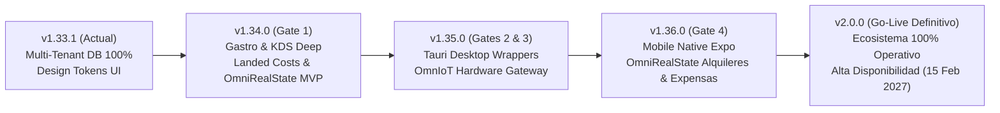

# 🗺️ ROADMAP DE ORDERFLOW - v1.34.0 → v2.0.0 (Go-Live Definitivo)
**Última Actualización:** 2026-10-22 (Release v1.40.2 — OmniGastro: editar y eliminar mesas desde `/admin/gastro/tables` + guardas de integridad — **desplegada y verificada en `provecchio.com`**)
**Release anterior:** 2026-10-22 (Release v1.40.1 — Marca Blanca: el `PATCH /api/v1/tenants/:id` devolvía 500 y podía borrar la configuración del tenant — desplegada y verificada en `provecchio.com`) · 2026-10-22 (Release v1.40.0 — endpoint `GET /api/v1/tenants/:id/config` desplegado en `provecchio.com`)

**Versión Actual:** **`v1.41.4`** ✅ **DESPLEGADA EN PRODUCCIÓN** (`provecchio.com`, 2026-10-23) | Marca pública: OmniFlow. Capa técnica interna: OrderFlow.
**Próximos Releases:** **v1.41.x** (Tauri Desktop & OmnIoT Edge) ➔ **v2.0.0** (🚀 **GO-Live Definitivo del Ecosistema — Target: 15 de Febrero de 2027**)
**Plan Maestro Go-to-Live:** ver [docs/plans/PLAN_GO_LIVE_APLICACIONES_ECOSISTEMA.md](docs/plans/PLAN_GO_LIVE_APLICACIONES_ECOSISTEMA.md)
**Roadmap Comercial:** ver [docs/planes/comercial/OmniFlow_PLAN_COMERCIAL_v1.md](docs/planes/comercial/OmniFlow_PLAN_COMERCIAL_v1.md) (FEAT-112 a FEAT-119)
**Estado:** ✅ **STAGING & PRODUCTION OPERATIVE** | 🏆 **HARDENED v1.39.2** | OmniGastro Fases 0-3.3 Completadas | RBAC Hardening En PR | CI Guard Active | QA E2E Suite | Build Limpio & Cobertura Total

<!--CURRENT_VERSION-->1.41.4<!--/CURRENT_VERSION--> <!-- Actualizado: 2026-10-23 v1.41.4 (productos POS + historial del Mozo POS) -->

### 📋 Próximas actualizaciones planificadas — OmniGastro (plan aprobado 2026-10-22)

> **Plan maestro:** [docs/plans/omnigastro/plan-actualizacion-v1.39.25-historial-pedidos-bandera-mozo.md](docs/plans/omnigastro/plan-actualizacion-v1.39.25-historial-pedidos-bandera-mozo.md)
> **Flujo y telemetría:** [docs/plans/omnigastro/flujo-historial-pedidos.md](docs/plans/omnigastro/flujo-historial-pedidos.md)
> **Estado:** 🟡 plan documentado y trazable — **esperando aprobación del usuario para iniciar la F1**.

**Decisiones tomadas por el cliente (2026-10-22):**

| # | Decisión | Consecuencia |
|---|---|---|
| **D3** | El historial del **comensal** queda **solo en la memoria del dispositivo**; el listado público de pedidos por mesa se **descarta** (quien escanee el QR de la mesa no accede a ningún pedido) | No habrá `GET /api/v1/guest/orders/by-table/:tableId` |
| **D2'** | El comensal **no** necesita recuperar su pedido desde otro dispositivo | La Capa 2 (código corto `publicCode`) pasa a **opcional**; la migración `public_code` no bloquea la F1 |
| **D3'** | La "memoria del sistema" es para **mozo y cajeros** (usuarios que inician sesión), en endpoints propios y autenticados | Se añade la **Capa 3b** (histórico de turnos de caja) |

| Fase | Versión | Feature | Alcance | Estado |
|---|---|---|---|---|
| **F1** | v1.39.25 | **FEAT-197** (Capa 1) | El comensal ve **"Mis pedidos"** en la memoria del dispositivo y no lo pierde al recargar, navegar o volver al menú (el carrito sí se vacía). Sin migración | ✅ **COMPLETADO** (v1.39.25) — store `public-orders-store` + botón 🕘 en el header + drawer con refresco cada 10 s |
| **F1** | v1.39.25 | **FEAT-197-d** (fix) | El cierre desde el panel de mozos nunca setea `paidAt`: `orders.controller.ts:271,276` espera `body.mode` pero el frontend envía `closeMode`/`method` → normalizar los 3 formatos | ✅ **COMPLETADO** (v1.39.25) — `order-close-mode.util.ts` + 7 unitarios + E2E |
| **F2** | v1.39.26 | **FEAT-194** ✅ **COMPLETADO** | **Bandera de Mozo**: solo los empleados con `Employee.canUseMozoPos` pueden iniciar sesión en el POS de mozo. Migración `20261022HHMMSS` + `getMozoStaff` + `GET /api/v1/users/mozo-staff` + `verify-pin` con `scope:'mozo'` + sección "Empleados Mozo" en `/admin/settings → OmniGastro` | 🟡 planificado |
| **F4** | v1.39.27 | **FEAT-197** (Capa 3 · mozo) ✅ **COMPLETADO** | El mozo **no pierde pedidos al cambiar de dispositivo**: `GET /api/v1/orders/guest/history` + `Order.waiterId` + `claimedById` persistido + pestaña "Atendidos" | 🟡 planificado |
| **F4b** | v1.39.27 | **FEAT-197** (Capa 3b · cajero) ✅ **COMPLETADO** | El cajero puede volver a ver los turnos ya cerrados: `GET /api/v1/pos-sessions` (listado, hoy inexistente) + pestaña "Historial de turnos" en `/admin/gastro/cashier`, reutilizando `Order.posSessionId` y el Reporte Z | 🟡 planificado |
| **F3** | v1.39.27 | FEAT-197 (Capa 2) | 🟡 **opcional** — recuperación del pedido del comensal desde otro dispositivo con un código corto | ⚪ opcional |

**Decisiones abiertas:** D1 backfill de la bandera para los mozos actuales (recomendado: sí) · D4 incluir el fix de `paidAt` en la F1 (recomendado: sí) · D5 implementar la Capa 2 ahora o esperar (recomendado: esperar) · D6 Capa 3b en fase propia o integrada en la F4 (recomendado: fase propia).

**Telemetría declarada** (`Order.metadata.guestDraft`): `t0_order_created`, `t1_table_claimed`, `t2_cart_saved`, `t3_order_confirmed`, `t4_sent_to_kitchen`, `t5_order_ready`, `t6_waiter_viewed_history`, `t7_paid`, `t11_table_closed`.

### 🚀 Release v1.39.28 — Fix de `/admin/hr` (500 en empleados, 404 en cargos) (Octubre 2026)

| Feature | Módulo | Estado |
|---------|--------|--------|
| **`PositionModule` registrado** en el `imports` del `AppModule` → `GET /api/v1/positions` deja de dar 404 | `backend/src/app.module.ts` | ✅ |
| **El restore aplica migraciones pendientes** (`prisma migrate deploy`) → el entorno local queda fiel al código y `GET /api/v1/hr/employees` deja de dar 500 | `scripts/restore-provecchio.sh` | ✅ |
| **E2E de regresión** de los tres endpoints de HR | `frontend/e2e/hr-endpoints.spec.ts` | ✅ 3 passed |
| **Troubleshooting #186** con el análisis del falso positivo de `_prisma_migrations` | `docs/troubleshooting/186-admin-hr-500-empleados-y-404-posiciones.md` | ✅ |

### 🚀 Release v1.39.27 — FEAT-197 (Capas 3 y 3b): historial en servidor para mozo y cajero (Octubre 2026)

| Feature | Módulo | Estado |
|---------|--------|--------|
| **`GET /api/v1/orders/guest/history`** (filtros por estado, mesa, mozo y límite) | `backend/src/orders/orders.controller.ts`, `orders.service.ts` | ✅ |
| **El mozo queda imputado al pedido**: `claimedById` en `metadata.guestDraft` y `waiterId` en `Order` al reclamar, marcar listo y cerrar | `backend/src/orders/orders.service.ts` | ✅ |
| **Vista "✅ Atendidos"** en el panel de mozos (+ filtro "solo los míos") | `frontend/src/pages/admin/gastro.tsx` | ✅ |
| **`GET /api/v1/pos-sessions`** (listado de turnos con estado, caja, cajero y nº de pedidos) | `backend/src/pos-sessions/` | ✅ |
| **Card "🗂️ Historial de Turnos"** con el Reporte Z en el panel de caja | `frontend/src/pages/admin/gastro-cashier.tsx` | ✅ |
| **Tests** | `frontend/e2e/order-history-server.spec.ts` (4) | ✅ suite 86 passed / 5 skipped / 0 failed · jest 130 |
| **Bump versión** | `VERSION`, `package.json` ×3, `featurelist.json`, Swagger, 55 manifiestos | ✅ 1.39.27 |

### 🚀 Release v1.39.26 — FEAT-194: bandera de Mozo (Octubre 2026)

| Feature | Módulo | Estado |
|---------|--------|--------|
| **Migración `Employee.canUseMozoPos`** (`can_use_mozo_pos`, snake_case) con **backfill D1** de los mozos de sala activos | `backend/prisma/migrations/20261022120000_add_can_use_mozo_pos_to_employees` | ✅ |
| **`GET /api/v1/users/mozo-staff`**: solo empleados con la bandera activa (deja de filtrar por texto de cargo) | `backend/src/users/services/users.service.ts`, `backend/src/users/users.controller.ts` | ✅ |
| **`verify-pin` con `scope:'mozo'`**: exige la bandera y responde *"no está habilitado para el POS de Mozo"* sin emitir token | `backend/src/auth/auth.service.ts`, `backend/src/auth/auth.controller.ts` | ✅ |
| **Sección "Empleados Mozo"** en `/admin/settings → OmniGastro` (tabla con switch por empleado) | `frontend/src/pages/admin/settings.tsx` | ✅ |
| **Switch "Puede abrir sesión en el POS de Mozo"** en el formulario de empleado | `frontend/src/pages/admin/hr.tsx` | ✅ |
| **Selector de mozos** consume el listado con bandera + aviso "Sin habilitación de Mozo" en el panel | `frontend/src/pages/admin/gastro-mozos.tsx`, `frontend/src/pages/admin/gastro.tsx` | ✅ |
| **Tests** | `frontend/e2e/mozo-flag.spec.ts` (3), `users.service.mozo-staff.spec.ts` (3), `auth.service.mozo-pin.spec.ts` (4) | ✅ |
| **Bump versión** | `VERSION`, `package.json` ×3, `featurelist.json`, Swagger, 55 manifiestos | ✅ 1.39.26 |

### 🚀 Release v1.39.25 — "Mis pedidos" del comensal + fix del `paidAt` al cerrar el pedido (Octubre 2026)

| Feature | Módulo | Estado |
|---------|--------|--------|
| **Store `public-orders-store`** (Zustand + `persist`, clave `gaia-spa-orders`, máx. 20 pedidos): el pedido se recuerda **antes** de vaciar el carrito | `frontend/src/store/public-orders-store.ts` | ✅ |
| **Botón 🕘 "Mis pedidos"** en el header del catálogo (con contador) + **drawer** con la lista, el estado, la mesa y el total; al tocar un pedido se abre su seguimiento | `frontend/src/pages/omni-catalog.tsx` | ✅ |
| **Refresco del historial** cada 10 s contra `GET /api/v1/guest/orders/:id` (el UUID lo conserva el propio comensal) | `frontend/src/pages/omni-catalog.tsx` | ✅ |
| **FEAT-197-d**: `normalizeOrderCloseMode` normaliza `mode` / `closeMode` / `method` / banderas → el cierre con cobro en mesa o pago digital **sí** escribe `paidAt` | `backend/src/orders/order-close-mode.util.ts`, `backend/src/orders/orders.controller.ts` | ✅ |
| **Privacidad (decisión D3)**: el historial es **local del dispositivo**; no existe endpoint público que liste pedidos por mesa | — | ✅ |
| **Tests**: 3 E2E nuevos (`frontend/e2e/order-tracking.spec.ts`), 7 unitarios backend, 6 unitarios frontend | — | ✅ E2E 79 passed / 5 skipped / 0 failed · jest 81 · vitest 26 |
| **Bump versión** | `VERSION`, `backend/package.json`, `frontend/package.json`, `mobile/package.json`, `featurelist.json`, Swagger, 55 manifiestos | ✅ 1.39.25 |
| **🚀 Deploy a `provecchio.com`** (2026-10-22 05:32, commit `52d6a4af`) | `scripts/deploy-production.sh provecchio` | ✅ health `1.39.25 ok`, 5 contenedores healthy, 8 rutas admin en verde — [reporte](docs/plans/omnigastro/DEPLOY_REPORT_2026-10-22.md) |
| **🚀 Deploy a `provecchio.com`** (v1.39.26 + v1.39.27, 2026-10-22 07:52, commits `141fa9dd` + `73d783d2`) | `scripts/deploy-production.sh provecchio` | ✅ health `1.39.27 ok`, 39 migraciones, 5 contenedores healthy, 8 rutas admin en verde — [reporte](docs/plans/omnigastro/DEPLOY_REPORT_2026-10-22-v1.39.26-27.md) |

### 🚀 Release v1.39.24 — POS del mozo (tablet): botón ☰ para mostrar y ocultar el catálogo (Octubre 2026)

| Feature | Módulo | Estado |
|---------|--------|--------|
| **Botón ☰ (hamburguesa) con etiqueta "Productos"** en el header del POS del mozo — en pantallas de menos de 768 px el catálogo solo existía dentro de un drawer cerrado y el mozo veía el POS sin productos | `frontend/src/pages/admin/gastro-pos.tsx` | ✅ |
| **El catálogo se muestra lateralmente** (drawer) en anchos estrechos y se alterna inline en anchos ≥768 px; el control deja de ser un ambiguo icono de ojo | `frontend/src/pages/admin/gastro-pos.tsx` | ✅ |
| **3 casos E2E nuevos** (existencia del botón, ciclo ocultar/mostrar, drawer en 410×915) | `frontend/e2e/pos-tablet-responsive.spec.ts` | ✅ 8 passed en el spec |
| **Bump versión** | `VERSION`, `backend/package.json`, `frontend/package.json`, `mobile/package.json`, `featurelist.json`, Swagger | ✅ 1.39.24 |
| **🚀 Deploy a `provecchio.com`** (release acumulada v1.39.22 + v1.39.23 + v1.39.24, 2026-10-21 21:53) | `scripts/deploy-production.sh provecchio` | ✅ health `1.39.24 ok`, 5 contenedores healthy, QA post-deploy con las 8 rutas admin en verde |

### 🚀 Release v1.39.23 — POS del mozo (vista por mesa): el pedido debe estar reclamado (Octubre 2026)

| Feature | Módulo | Estado |
|---------|--------|--------|
| **La vista POS por mesa reclama el pedido antes de enviarlo a cocina** — el mozo recibía `400 "El pedido aún no fue reclamado por el mozo"` en `POST /orders/:id/ready` (solo en laptop: en tablet se usa el panel de mozos, que ya reclamaba) | `frontend/src/pages/admin/gastro-pos.tsx` | ✅ |
| **`sendToKitchen` exige el reclamo previo** para pedidos guest (el control `claimedBy` faltaba; ya existía en `guestMarkReady`, `guestUpdateItems`, `guestPaymentPreconfirm`, `guestMarkPaid` y `guestTransferToPerson`) | `backend/src/orders/orders.service.ts` | ✅ |
| **Bump versión** | `VERSION`, `backend/package.json`, `frontend/package.json`, `mobile/package.json`, `featurelist.json`, Swagger | ✅ 1.39.23 |

### 🚀 Release v1.39.22 — Tres módulos del panel admin devolvían 404 (Octubre 2026)

| Feature | Módulo | Estado |
|---------|--------|--------|
| **`/admin/social-catalog`, `/admin/loyalty` y `/admin/gastro/kds-stations` restaurados** — las rutas fueron borradas del router por el commit `7f6bae00` (2026-10-17) y los *lazy imports** quedaron muertos | `frontend/src/AdminApp.tsx` | ✅ |
| **Test de regresión** que exige que cada enlace del `Sidebar` tenga su ruta registrada y que ninguna página importada quede sin montar (2ª ocurrencia de la misma clase, tras troubleshooting #160) | `frontend/src/components/sidebar-routes.test.ts` | ✅ |
| **QA E2E post-deploy autenticado** y con detección de la pantalla 404 del router (antes era un no-op: sin sesión el router redirigía a `/login` y solo se miraba el HTTP status) | `scripts/qa_e2e_check.py` | ✅ |
| **Bump versión** | `VERSION`, `backend/package.json`, `frontend/package.json`, `mobile/package.json`, `featurelist.json`, Swagger | ✅ 1.39.22 |

### 🚀 Release v1.39.21 — La suite E2E del frontend deja de apuntar a producción (Octubre 2026)

| Feature | Módulo | Estado |
|---------|--------|--------|
| **8 specs E2E con default `provecchio.com`** — el job de CI corría la suite contra producción, que crea mesas, abre/cierra turnos de caja y envía pedidos a cocina | `frontend/e2e/*.spec.ts` | ✅ Corregido a `provecchio.local` |
| **Proxy `/api` del dev server** apuntaba a `:3000` en lugar del backend local en `:3010` (10 tests caían por timeout de API) | `frontend/vite.config.ts`, `frontend/.env.example` | ✅ |
| **Dev server no arrancaba** con `PLAYWRIGHT_BASE_URL` definido | `frontend/playwright.config.ts` | ✅ |
| **Job `Frontend E2E`** informational + URLs fijas explícitas (el gate bloqueante sigue siendo el workflow `QA E2E (Playwright + Python)`) | `.github/workflows/ci-cd.yml` | ✅ |
| **Estado del CI documentado**: la cuenta no tiene fondos para Actions (spending limit) → sin runners; la verificación se replica 100 % en local | `docs/troubleshooting/185-github-actions-spending-limit-no-runners.md` | ⚠️ **ABIERTO** (requiere topped-up) |
| **Análisis del bug 404**: `/admin/social-catalog`, `/admin/loyalty` y `/admin/gastro/kds-stations` sin `<Route>` (borradas por el commit `7f6bae00`) | `docs/troubleshooting/184-admin-routes-social-catalog-loyalty-kds-stations-404.md` | 🔍 **ANALIZADO** (fix pendiente de aprobación) |
| **Bump versión** | `VERSION`, `backend/package.json`, `frontend/package.json`, `mobile/package.json`, `featurelist.json`, Swagger | ✅ 1.39.21 |

> **TODO — Job `Frontend E2E` informativo:** la suite de Playwright del frontend exige un stack **completamente sembrado** (tenant con usuario admin, cajas registradoras con turno, mesas con token QR, PIN de mesero, catálogo y proveedor de importación) que CI no aprovisiona. Por eso el job quedó como informativo (`continue-on-error`) en `.github/workflows/ci-cd.yml`. El gate E2E **bloqueante** sigue siendo el workflow `QA E2E (Playwright + Python)`, que corre contra el entorno desplegado con aserciones de solo lectura. Próximo paso: seed reproducible por tenant + `docker compose` de pruebas en CI para promover el job a bloqueante.

### 🚀 Release v1.39.20 — Fix del Service Worker (PWA) + hardening del pipeline de CI (Octubre 2026)

| Feature | Módulo | Estado |
|---------|--------|--------|
| **Fix del service worker que servía la versión anterior** — `index.html` salía del precache de Workbox, `navigateFallback: null` y navegaciones con `NetworkFirst` | `frontend/vite.config.ts` | ✅ Production Ready |
| **Guard de versión en el frontend** — compara el bundle contra `GET /api/v1/health` y ofrece **Actualizar ahora** limpiando cachés y recargando | `frontend/src/components/version-guard.tsx`, `frontend/src/main.tsx` | ✅ |
| **Pipeline de CI en verde** — `react-qr-code@2.2.0` (ERESOLVE), `gitleaks` en GHCR, deps directas de Expo en mobile, props `id` eliminados de expo-router v6 | `frontend/package.json`, `mobile/package.json`, `mobile/app/**/_layout.tsx` | ✅ |
| **Workflow `qa_e2e` operativo** — `secrets` fuera de `strategy`, `CATALOG_PATH=/social-catalog`, deps de sistema vía `playwright install --with-deps` (la lista manual fallaba en ubuntu-24.04) | `.github/workflows/qa_e2e.yml` | ✅ |
| **OOM de Node eliminado del backend** — `NODE_OPTIONS=--max-old-space-size=4096` en typecheck y build de NestJS (exit 134 → "heap out of memory") | `.github/workflows/ci.yml`, `.github/workflows/ci-cd.yml` | ✅ |
| **Política de lint por ratchet** y **gate de auditoría de producción** (`--omit=dev --audit-level=critical`) | `.github/workflows/ci.yml` | ✅ |
| **Gobierno de versiones** — `VERSION` raíz como única fuente de verdad; `backend/VERSION` y `frontend/VERSION` huérfanos eliminados; `sync-version.sh` sin destruir el historial del changelog | `scripts/sync-version.sh`, `scripts/check-version-sync.sh`, `backend/src/health/health.controller.ts` | ✅ |
| **Deuda de lint/tsc saneada** — 8 errores FE + 86 BE, 0 errores de TypeScript (incluido bug real en `AvailabilityCheckResponseDto.conflicts`) | backend y frontend | ✅ |
| **Bump versión** | `VERSION`, `backend/package.json`, `frontend/package.json`, `mobile/package.json`, `featurelist.json`, Swagger | ✅ 1.39.20 |
| **E2E de frontend sin riesgo sobre producción** (8 specs apuntaban a `provecchio.com` por defecto) + proxy del dev server corregido a `:3010` | `frontend/e2e/*.spec.ts`, `frontend/vite.config.ts`, `frontend/playwright.config.ts`, `frontend/.env.example` | ✅ 73 passed / 0 failed |

### 🚀 Release v1.39.19 — Cierre de turno con arqueo y relevo de cajero en Caja Gastro (Octubre 2026)

| Feature | Módulo | Estado |
|---------|--------|--------|
| **FEAT-196 — Botón "Cerrar turno" con arqueo y Reporte Z** (consume `GET /api/v1/pos-sessions/:id/report`, declara el efectivo contado, muestra faltante/sobrante) | `frontend/src/pages/admin/gastro-cashier.tsx` | ✅ Production Ready |
| **Nuevo endpoint `POST /api/v1/pos-sessions/:id/switch-cashier`** (`CashManagementService.switchCashierByPin` — relevo que conserva caja, fondo y movimientos) | `backend/src/pos/cash-management.service.ts`, `backend/src/pos-sessions/pos-sessions.controller.ts` | ✅ |
| **Fix de detección de sesión activa** (`useMemo` derivado en lugar de `setState` con closure obsoleta) + auto-selección de caja y bloqueo de apertura duplicada | `frontend/src/pages/admin/gastro-cashier.tsx` | ✅ |
| **Auditoría de caja incluida en el cierre** (`cashRegister` en la respuesta de `closeSession`) | `backend/src/pos-sessions/pos-sessions.service.ts` | ✅ |
| **Tests** (7 unitarios nuevos + 2 E2E nuevos: cierre desde la UI y relevo) | `backend/src/pos/cash-management.service.spec.ts`, `frontend/e2e/cashier-cash-register-flow.spec.ts` | ✅ 20 unitarios / 5 E2E |
| **Documentación** | `docs/plans/omnigastro/auditoria-caja-cierre-relevo-2026-10-21.md` | ✅ |
| **Bump versión** | `VERSION`, `backend/package.json`, `frontend/package.json`, `featurelist.json`, Swagger | ✅ 1.39.19 |

### 🚀 Release v1.39.18 — Cobro centralizado multi-caja: la sesión se ancla a la caja física (Octubre 2026)

| Feature | Módulo | Estado |
|---------|--------|--------|
| **FEAT-193 — La sesión de caja se ancla a la caja registradora** (`pos_sessions.cash_register_id`) | `backend/src/pos/cash-management.service.ts`, `backend/src/pos/cash-register.service.ts` | ✅ Production Ready |
| **Control de acceso por caja** (`cash_register_access.can_open` + ficha de empleado del cajero) | `backend/src/pos/cash-register.service.ts` | ✅ |
| **Fix de rutas del panel de caja** (`/api/v1/pos/sessions/*` → `/api/v1/pos-sessions/*`) y `configId` opcional | `frontend/src/pages/admin/gastro-cashier.tsx` | ✅ |
| **Nuevo endpoint `GET /api/v1/pos-sessions/open`** (turnos abiertos con caja y cajero) | `backend/src/pos-sessions/pos-sessions.controller.ts` | ✅ |
| **Cajas de producción** (4 cajas + 10 accesos: Principal, Barra, Terraza, Auxiliar) | DB `provecchio-dimora-001` | ✅ |
| **Documentación** | `docs/plans/omnigastro/auditoria-caja-sesion-caja-fisica.md`, `docs/plans/omnigastro/manual-caja-cobro-centralizado.md` | ✅ |
| **Bump versión** | `VERSION`, `backend/package.json`, `frontend/package.json`, `featurelist.json`, manifiestos POS | ✅ 1.39.18 |

### 🚀 Release v1.39.11 — Sincronización OrderFlow → Odoo 14 POS (Octubre 2026)

| Feature | Módulo | Estado |
|---------|--------|--------|
| **FEAT-184 — Mapeo de mesas OrderFlow ↔ Odoo** (`odoo_table_id`, listener con id numérico, UI de mapeo) | `backend/prisma/`, `backend/src/tables/`, `backend/src/orders/odoo-table-sync.listener.ts` | ✅ Production Ready |
| **FEAT-185 — Addon Odoo 14 `pos_omniflow_sync` parcheado** (`pos.order` creable por RPC) | `odoo-adapter/odoo-addons/pos_omniflow_sync/`, `scripts/deploy-odoo-addon.sh` | ✅ Desplegado con backup + rollback |
| **FEAT-186 — Sync en el cierre de mesa** + cobro en mesa configurable por tenant | `backend/src/orders/orders.service.ts`, `backend/src/modules/omnigastro-config/` | ✅ Production Ready |
| **FEAT-187 — Config unificada del adapter** (`ODOO_DB=prod`) y retirada del worker legacy | `docker-compose.yml`, `odoo-adapter/src/` | ✅ |
| **FEAT-188 — Telemetría t0…t5 + 5 métricas Prometheus** | `backend/src/queues/odoo-sync-telemetry.service.ts`, `backend/src/metrics/` | ✅ |
| **Modal de editar mesa restaurado** (bug #8a del reporte del cliente) | `frontend/src/pages/admin/gastro-tables.tsx` | ✅ |
| **Documentación** | `docs/plans/omnigastro/PLAN_ODOO_POS_SYNC_2026-10-19.md`, `flujo_odoo-pos-sync.md` | ✅ |
| **Bump versión** | `VERSION`, `backend/package.json`, `frontend/package.json`, `featurelist.json`, 60+ manifiestos | ✅ 1.39.11 |

### 🚀 Release v1.39.10 — Backend crash-loop: Socket.IO + Redis adapter (Octubre 2026)

| Feature | Módulo | Estado |
|---------|--------|--------|
| **Fix `unhandledRejection` en adapter de Socket.IO/Redis** (`Stream isn't writeable`) | `backend/src/common/redis-io.adapter.ts` | ✅ Production Ready |
| `await subClient.connect()` antes de `createAdapter`; password enmascarada en logs; `safeQuit()` en fallback | | ✅ |
| **Guard acotado de `unhandledRejection` (solo Redis)** | `backend/src/main.ts` | ✅ Production Ready |
| Pub/sub no crítico no tumba el proceso; el resto conserva `process.exit(1)` | | ✅ |
| **Config de Redis en compose local + `env_file`** | `docker-compose.yml` | ✅ |
| `REDIS_URL` / `REDIS_PASSWORD` / `ENABLE_REDIS_WS` / `env_file: .env` (fix `JWT_SECRET` ausente) | | ✅ |
| **Documentación** | `docs/troubleshooting/182-*.md` + índice | ✅ |
| **Bump versión** | `VERSION`, `backend/package.json`, `frontend/package.json`, `featurelist.json` | ✅ 1.39.10 |
| **E2E Playwright** | `frontend/e2e/` | ✅ 64/64 OK vs `provecchio.local` y vs `provecchio.com` |

### 🚀 Release v1.39.10 — Deploy a producción Provecchio (Octubre 2026)

| Feature | Módulo | Estado |
|---------|--------|--------|
| **Deploy a provecchio.com** (autorizado por el usuario) | `scripts/deploy-production.sh` | ✅ En producción |
| SSH del deploy con `root@` (17 invocaciones) — evita `permission denied` sobre `.env.provecchio` | | ✅ |
| **Build del frontend en el servidor** (`node:20-alpine` + `vite build --mode provecchio`) | | ✅ |
| `docker-compose.provecchio.yml`: `REDIS_URL`/`DATABASE_URL` con interpolación (fin del placeholder) | | ✅ |
| `sync_standalone` / `omnibi_standalone` operativos (auth-shared, bind mount, Redis, healthcheck, base `orderflow_bi`) | | ✅ 9/9 healthy |
| **E2E Playwright en producción** | `frontend/e2e/` | ✅ 64/64 OK vs `provecchio.com` |
| **Documentación** | `docs/troubleshooting/183-*.md` + índice | ✅ |

---

### 🚀 Release v1.39.2 — OmniGastro Bug Fixes Post-v1.39.1 (Octubre 2026)

| Feature | Módulo | Estado |
|---------|--------|--------|
| **Bug 1 — KDS Stations categorías padre/hoja independientes + excluir subcategorías** | `frontend/src/pages/admin/gastro-kds-stations.tsx` | ✅ Production Ready |
| Tres Selects multivalor independientes; acción "Seleccionar todas las hojas de padres"; persiste `categories` combinado | | ✅ |
| **Bug 2 — Tables sync: unificar fuente a `/api/v1/tables/floor-map`** | `frontend/src/pages/admin/gastro.tsx` | ✅ Production Ready |
| Modal y listado muestran mismas mesas activas; refetch tras CRUD | | ✅ |
| **Bug 4 — Cargar pedidos por mesa / sin mesa (takeout)** | `frontend/src/pages/admin/gastro.tsx`, `backend/src/orders/orders.controller.ts`, `backend/src/orders/orders.service.ts` | ✅ Production Ready |
| Botón "Cargar Pedido"; `tableId=null` + `orderType=TAKEOUT`; navegar al POS | | ✅ |
| **Bug 5 — Modal responsivo en panel de mozos sin overflow** | `frontend/src/pages/admin/gastro.tsx` | ✅ Production Ready |
| `width` breakpoints, `bodyStyle` overflowY, `ellipsis`, `scroll x`, tokens de tema | | ✅ |
| **Bump versión** | `VERSION`, `backend/package.json`, `frontend/package.json`, `featurelist.json` | ✅ 1.39.2 |
| **E2E Playwright** | `frontend/e2e/` (4 specs) | ✅ Production Ready |

---


| Feature | Módulo | Estado |
|---------|--------|--------|
| **Monolito → omnibi-standalone proxy** | `backend/src/analytics/analytics.service.ts` | ✅ Production Ready |
| `getYoYComparison()` / `getHistoricalSyncStatus()` / `triggerOmniBiSync()` | Reemplazan mock data por HTTP calls a standalone (port 3027) | ✅ Verificado |
| **Proxy endpoint** | `backend/src/analytics/analytics.controller.ts:315` | ✅ Production Ready |
| `POST /api/v1/analytics/omnibi/sync/odoo14` | `@RequirePermissions('analytics:write')`, despacha a standalone | ✅ |
| **Extractor pagination + BOMs** | `services/omnibi-standalone/src/extractors/odoo-historical-extractor.ts` | ✅ Production Ready |
| `paginateAll()` (500/page, 2000 pages max) + `extractBoms()` + `maxWriteDate` tracking | Corrige extracción directa sin paginación y BOMs nunca extraídos | ✅ |
| **`omnibi.service.ts` rewrite** | Usa `paginateAll()` para 4 modelos, checkpoints con Odoo `write_date` | ✅ Production Ready |
| Checkpoints `bi_sync_checkpoints` guardan `maxWriteDate` (no `new Date()`) | Permite sync incremental | ✅ |
| **Frontend theme tokens** | `frontend/src/pages/admin/bi.tsx` | ✅ Production Ready |
| `token.colorPrimary` / `token.colorBgContainer` | Sin colores hardcodeados `#1677ff`/`#fafafa` | ✅ |
| **`docker-compose.prod.yml`** | Service `omnibi_standalone` (port 3027) | ✅ Production Ready |
| Traefik `bi.provecchio.com` → `orderflow_omnibi_standalone:3027` | Routers verificados en `services.yml` | ✅ |
| Deploy provecchio.com v1.38.19 | Contenedores healthy, health endpoint OK | ✅ Completado |

| Feature | Módulo | Estado |
|---------|--------|--------|
| **Fix Categories Endpoint** | `frontend/src/pages/admin/gastro-pos.tsx:66` | ✅ Production Ready |
| Endpoint correcto: `/api/v1/catalog/categories/tree?includeProducts=true` | Reemplaza `/api/v1/categories?includeProducts=true&tree=true` (404) | ✅ Verificado 200 |
| **Table-by-ID Endpoint** | `backend/src/tables/tables.controller.ts`, `tables.service.ts` | ✅ Production Ready |
| `GET /api/v1/tables/:id` | Retorna mesa con piso, capacidad, zona | ✅ Verificado 200 |
| **Orders Endpoint Verificado** | `GET /api/v1/orders?tableId=...` | ✅ Verificado 200 |
| Error 500 previo fue transitorio | DRAFT orders con líneas | ✅ Verificado |
| **Seguridad Mozo v1.38.15 (incluida)** | PIN estricta API-only, auto-asignación, nav POS | ✅ Production Ready |
| Deploy provecchio.com v1.38.16 | Contenedores healthy, health endpoint OK | ✅ Completado |

---

### 🚀 Release v1.36.4 — OmniGastro KDS Multi-Estación + RBAC Hardening (Septiembre 2026)

| Feature | Módulo | Estado |
|---------|--------|--------|
| **FEAT-151/152 — KDS Configurable Multi-Estación + Impresión Selectiva** | `backend/src/kds/`, `backend/src/queues/`, `backend/prisma/schema.prisma` | ✅ Production Ready |
| **ProductPreparationStation (N:N)** | Tabla intermedia producto-estación | ✅ Production Ready |
| **KitchenPrintService + ESC/POS** | `backend/src/kds/kitchen-print.service.ts` | ✅ Scaffolding + cola BullMQ |
| **Routing Multi-Destino** | `OrdersService.sendToKitchen` agrupa líneas por estación | ✅ Production Ready |
| **WebSocket por estación** | `tenant:{tenantId}:station:{stationId}` | ✅ Production Ready |
| **Admin UI KDS Stations** | `/admin/kds/stations` (`gastro-kds-stations.tsx`) | ✅ Production Ready |
| **RBAC Hardening — PermissionsGuard** | Cierre bypass API key | ✅ En PR #1 |
| **RBAC Hardening — RbacService** | Cierre bypass MANAGER + seed extendida | ✅ En PR #1 |
| **StepUpGuard** | Autorización PIN para acciones críticas (gift, Z) | ✅ En PR #1 |
| **4 permisos nuevos** | `tables:status`, `tables:guests`, `tables:gift`, `pos:config` | ✅ En PR #1 |
| **E2E Playwright OmniGastro** | Suites estabilizadas | ✅ Production Ready |

---

### 🚀 Release v1.37.0 — Provecchio Failover + Pre-Deploy Diagnostics + OmniGastro Sprint (Septiembre 2026)

| Feature | Módulo | Estado |
|---------|--------|--------|
| **Réplica PostgreSQL Failover Provecchio** | `docker-compose.provecchio.yml`, `scripts/replica-entrypoint.sh` | ✅ Production Ready |
| **Entrypoint custom réplica** | Backup inicial condicional, `postgresql.auto.conf`, `standby.signal`, `su-exec postgres` | ✅ Production Ready |
| **Auth replica en primary** | `pg_hba.conf` + `ports: 5432:5432` temporal en `docker-compose.prod.yml` | ✅ Resuelto |
| **Protocolo pre-deploy** | `scripts/pre-deploy-diagnostic.sh` integrado en `deploy-production.sh` | ✅ Production Ready |
| **Troubleshooting #163** | Documentación completa del fix integral de réplica | ✅ Documentado |
| **Plan Tailscale/NetBird** | `docs/plans/omni-gastro/plans/tailscale-provecchio-replica.md` | 📋 Planificado |
| **Sprint Provecchio — OmniGastro** | Fixes de campo en modal llamada mozo, panel admin reactivo, sonido, RBAC por PIN | ✅ Completado |
| **Backup con filestore** | Plan post-sprint en `docs/plans/omnigastro/backups-filestore-post-sprint.md` | 📋 Planificado |

---

<!--CURRENT_VERSION-->1.41.4<!--/CURRENT_VERSION--> <!-- Actualizado: 2026-10-20 v1.39.12 por Kilo -->

El ecosistema **OmniFlow** contempla 10 aplicaciones y capas operativas. A continuación se presenta la evaluación de madurez técnica por componente y los puntos pendientes priorizados hacia el Go-Live final.

### 📊 Matriz de Madurez del Sistema (Audit Q3 2026)

| Módulo / Aplicación | Tipo / Runtime | Madurez (%) | Estado Actual | Brecha / Puntos Pendientes para Go-Live | Target Release |
|---------------------|----------------|-------------|---------------|------------------------------------------|----------------|
| **Core Multi-Tenant SaaS** | NestJS 10 / PostgreSQL 15 | **95%** | ✅ Production Ready | Aislamiento DB 100% (v1.33.1). Pendiente: afinamiento final de métricas HA. | **v1.33.1** |
| **Suite Microservicios Standalone** | PWA / Web (`:3020`-`:3027`) | **92%** | ✅ Production Ready | BioLinks, Catalog, Bookings, Giveaways, OmniBI y OmniLedger operando en Traefik. | **v1.33.1** |
| **OmniGastro & KDS Multi-Estación** | Web / PWA / WebSockets | **95%** | ✅ Production Ready | Fases 0-3.1 completadas (FEAT-112 a FEAT-152). KDS configurable multi-estación + impresión ESC/POS + RBAC hardening en PR. | **v1.36.4** |
| **OmnIoT Edge Hardware Gateway** | Tauri / Rust Native Daemon | **70%** | 🔄 Desarrollo Avanzado | Emulador Epson ePOS, lectura básculas RS-232, ESC/POS TCP/USB daemon systemd en Debian/Radxa. | **v1.35.0** |
| **Tauri v2 Desktop Wrappers** | Tauri v2 / Rust Kiosk | **65%** | 🔄 Staging Web | Empaquetado binarios `.AppImage` (Linux) y `.msi` (Windows) para OmniPOS Retail, Gastro y KDS. | **v1.35.0** |
| **OmniMobile Monorepo & Apps (`mobile/apps/*`)** | React Native / Expo Monorepo | **65%** | 🔄 En desarrollo (`FEAT-160`) | Estructuración Monorepo (`apps/app-waiter`, `app-customer`, `app-admin` + `packages/*`). `app-waiter` v1.0 en fase de preparación post-PWA. | **v1.36.0** |
| **Alta Disponibilidad / Standby Replica** | PostgreSQL Streaming / Traefik | **75%** | ✅ Failover Activo | Réplica Provecchio operativa para failover; pendiente migración a Tailscale/NetBird para cerrar puerto 5432 públicamente. | **v1.37.0** |
| **OmniRealState (Vertical PropTech)** | Standalone Service (`:3028`) | **35%** | 📋 Plan & Specs Completos | Fast-Track MVP (`services/real-estate-standalone/`), SideBar Refine, GeoJSON, contratos, expensas, mora y liquidaciones. | **v1.34.0 (MVP) → v1.36.0** |
| **Scheduling Core (Feature Granular)** | NestJS Module / Core Service | **5%** | 📋 Documentación Iniciada | Motor de scheduling multi-tenant extraído de cal.diy: disponibilidad avanzada, calendar sync, video conferencing, webhooks. Consumido por bookings, OmniCRM, HR, POS. Docs: `docs/plans/scheduling/`. | **v1.36.0 → v1.41.0** |

---

### 🏁 Puertas de Calidad (Quality Gates) para Salida a Producción



1. **Gate 1 — Core & Gastro Alignment & OmniRealState Fast-Track MVP (Release v1.34.0 — Octubre 2026):**
   - Completar Landed Costs (Paso 8) en inventario.
   - Afinamiento de recetas BoM y comanderas en tiempo real.
   - Fast-Track MVP `OmniRealState` (`services/real-estate-standalone/` en puerto `:3028`), SideBar Refine "Inmobiliaria / PropTech", esquemas `@TenantPrisma()` y visores GeoJSON.
   - Ejecución limpia de suite de tests unitarios y Playwright E2E (`./scripts/init.sh`).

2. **Gate 2 & 3 — Desktop Tauri & OmnIoT Edge Gateway (Release v1.35.0 — Noviembre 2026):**
   - Binarios ejecutables Tauri v2 (`.AppImage` y `.msi`) para OmniPOS Retail, Gastro y KDS.
   - Instalación de daemon `omniot` en nodos hardware Debian/Radxa.
   - Certificación de impresión ESC/POS y pesaje RS-232 en balanzas industriales.

3. **Gate 4 — Mobile Launch & Offline-First (Release v1.36.0 — Enero 2027):**
   - Compilación e instalación de APK/IPA `@orderflow/mobile` para meseros.
   - Pruebas de cobro Tap-to-Pay / NFC y experiencia offline-first.

4. **Gate 5 — Go-Live Definitivo del Ecosistema (Release v2.0.0 — 15 de Febrero de 2027):**
   - Despliegue masivo en alta disponibilidad (Hetzner VPS + Provecchio).
   - Onboarding zero-touch multi-tenant para producción comercial.

---

## 📊 ESTADO ACTUAL - MÓDULOS PRODUCTION READY

| Módulo | Estado | Producción | Staging | Notas |
|--------|--------|------------|---------|-------|
| **Multi-Tenant Core & Multi-Tier** | ✅ Completo | ✅ Sí | ✅ Sí | Auth JWT + API Key, DB dedicada por tenant enterprise, `@TenantPrisma()` |
| **Inventario Landed Costs (Paso 8)** | ✅ Completo | ✅ Sí | ✅ Sí | Prorrateo de costes de destino en OC con recálculo atómico PMP `costPricePmp` (v1.20.41) |
| **Wizard Onboarding Odoo 1-Click** | ✅ Completo | ✅ Sí | ✅ Sí | `<OdooOnboardingWizardModal>` en SuperAdmin Dashboard `/admin/deploy` (v1.20.41) |
| **Motor LLM Local (OmniAI)** | ✅ Completo | ✅ Sí | ✅ Sí | Inferencia IA local (Ollama / vLLM llama3) vía Traefik SSL `ai.provecchio.com` (FEAT-105) |
| **Zero-Touch Odoo Onboarding** | ✅ Completo | ✅ Sí | ✅ Sí | Onboarding en 1-Click mediante manifiesto JSON `tenant_manifest.json` (FEAT-106) |
| **OmniFlow DataView Suite** | ✅ Completo | ✅ Sí | ✅ Sí | DynamicQueryBuilder, selección global `mode: all`, presets `SavedViews` y UI DataView Kit (v1.20.39) |
| **Documents Workspace & Collabora** | ✅ Completo | ✅ Sí | ✅ Sí | Explorador multi-tenant, WOPI session, visor/editor interactivo Collabora y locking Redis (FEAT-083 & FEAT-082) |
| **Compras & Finanzas Multi-Moneda** | ✅ Completo | ✅ Sí | ✅ Sí | Órdenes de Compra (OC), impacto atómico Kardex, Facturas Proveedor (AP) y Flujo de Caja (FEAT-104) |
| **Dynamic Multi-Currency Engine** | ✅ Completo | ✅ Sí | ✅ Sí | Cotización bursátil en tiempo real (PYG, USD, BRL, ARS) BCP/Cambios Chaco/DolarApi y caché LRU (FEAT-103) |
| **OmniBI Analytics Standalone** | ✅ Completo | ✅ Sí | ✅ Sí | Ingesta histórica Odoo 14 XML-RPC, comparativo YoY y microservicio `:3027` (FEAT-100) |
| **Storefront Builder Standalone** | ✅ Completo | ✅ Sí | ✅ Sí | Diseñador visual Drag & Drop desacoplado `:3026` (FEAT-099) |
| **Fuerza de Ventas B2B** | ✅ Completo | ✅ Sí | ✅ Sí | Presupuestos B2B, listas de precios mayoristas Odoo y descuentos por volumen (FEAT-098) |
| **OmniPOS & KDS Multi-Estación** | ✅ Completo | ✅ Sí | ✅ Sí | Cobro rápido, semáforo SLA comanda y explosión atómica de recetas BoM (FEAT-097) |
| **OmniManufacturing MRP Engine** | ✅ Completo | ✅ Sí | ✅ Sí | Órdenes de Fabricación, insumos, mermas scrap y conversión UoM ($g \leftrightarrow kg$) (FEAT-096) |
| **WhatsApp Catalog & Standalone** | ✅ Completo | ✅ Sí | ✅ Sí | Catálogo, carrito, checkout y standalone microservice `:3021` |
| **Social Commerce Hub** | ✅ Completo | ✅ Sí | ✅ Sí | Soporta WhatsApp, Telegram, Instagram, Messenger y Custom Webhook |
| **Bio-Links & Standalone** | ✅ Completo | ✅ Sí | ✅ Sí | API + Redis + Admin Drag&Drop + Public SPA, standalone microservice `:3022` |
| **Super Admin** | ✅ Completo | ✅ Sí | ✅ Sí | Usuarios, tenants, roles, disable/enable/delete tenant, DB tier toggle |
| **Bookings (Spa) & Standalone** | ✅ Completo | ✅ Sí | ✅ Sí | Turnos, comisiones, atomicidad y standalone microservice `:3023` |
| **Quotations & Standalone** | ✅ Completo | ✅ Sí | ✅ Sí | Presupuestos, integración DNIT y standalone microservice `:3024` |
| **Loyalty & Standalone** | ✅ Completo | ✅ Sí | ✅ Sí | Tarjetas, reglas, redención, tiers BRONZE→PLATINUM y standalone microservice `:3025` |
| **Giveaway & Standalone** | ✅ Completo | ✅ Sí | ✅ Sí | Sorteos virales y standalone microservice `:3020` |
| **Cloudflare / DNS & Traefik** | ✅ Completo | ✅ Sí | ✅ Sí | Subdominios automáticos + Traefik v3.4 routing por microservicio |
| **Integrations (Odoo)** | ✅ Completo | ✅ Sí | ✅ Sí | OrderFlow ↔ Odoo: webhooks push + wizard pull + addons nativos Odoo 14, 18 y 19 CE |
| **Alta Disponibilidad / Réplica Standby** | 🔄 En progreso | 🔄 Parcial | 🔄 Parcial | Réplica read-only en Provecchio con failover documentado (FEAT-011) |
| **App Móvil Client-First & POS Native** | 🔄 En progreso | 🔄 Parcial | 🔄 Parcial | `@orderflow/mobile` Expo, catálogo, carrito, POS offline-first (FEAT-012) |


### 🏭 Estandarización de Inventario (v1.20.38)

| Paso | Objetivo | Estado |
|------|----------|--------|
| **Paso 1** | Auditoría de lectores/escritores de `stockAvailable` | ✅ Completado |
| **Paso 2** | Extender `executeStockMove()` para mantener cache `Product.stockAvailable` | ✅ Completado |
| **Paso 3** | Migrar `orders.service.ts` a motor de doble entrada | ✅ Completado (detrás de Feature Flag `USE_DOUBLE_ENTRY_STOCK`) |
| **Paso 4** | Migrar escritores restantes (products, sync, variants, batch import, admin) | ✅ Completado |
| **Paso 5** | Limpiar lecturas y documentar `stockAvailable` como cache | ✅ Completado |
| **Paso 6** | Reservas de stock (`stockReserved`) | ✅ Completado (`reserveStock` / `releaseStockReservation`) |
| **Paso 8** | Landed cost + impuestos (PurchaseReceipt, CostAdjustment, unitCost en StockQuant) | ⏳ Pendiente |

> 📄 Plan detallado: `docs/planes/inventario/plan-estandarizacion-inventario-omniflow.md`

#### ⚠️ Estrategia Segura — Paso 3 (Migración de `orders.service.ts`)

**NO se implementará en el mismo release que Pasos 1-2.**

Motivo: `orders.service.ts` es el flujo de ventas productivo. Cualquier cambio aquí debe:
1. Desarrollarse en una rama feature separada.
2. Testearse exhaustivamente en staging con datos reales.
3. Implementarse detrás de un feature flag (`USE_DOUBLE_ENTRY_STOCK`) para permitir rollback instantáneo.
4. Solo entonces mergearse a `main` y etiquetarse como release `v1.21.0`.

Mientras tanto, `Product.stockAvailable` se mantiene sincronizado como cache por `executeStockMove()` (Paso 2).


---

### 🚀 Release v1.20.9 - Mobile Alignment & OmniFlow Rebranding (FEAT-012)

| Feature | Estado |
|---------|--------|
| **Mobile Branding:** `app.json` y `package.json` alineados a **OmniFlow**, versión `1.20.9`. | ✅ Completo |
| **API Base Path:** cliente móvil centralizado bajo `/api/v1` en `src/services/api.ts`. | ✅ Completo |
| **POS Offline-First:** `POSScreen` mantiene modo offline, cola de pedidos y multi-sesión. | ✅ Completo |

---

### 🚀 Release v1.20.8 - Schema Decoupling Completado + Rebranding OmniFlow (FEAT-065 + FEAT-066)

| Feature | Estado |
|---------|--------|
| **Schema Decoupling (Fase 3 - Bio-Links):** Schema standalone propio en `services/biolinks-standalone/prisma/schema.prisma` (`BioLink`, `BioLinkClick`). Cliente Prisma aislado generado. Refactor a `PrismaService` + `CoreHttpService` propio. | ✅ Completo |
| **Rebranding OmniFlow (FEAT-066):** Estandarización de nombres comerciales: OmniBio (`biolinks-standalone`), OmniCatalog (`social-catalog-standalone`), OmniBookings (`bookings-standalone`). Retrocompatibilidad total en rutas legacy. | ✅ Completo |
| **Validación:** `init.sh` OK | 74 suites / 580 tests passed | Backend + Frontend builds limpios | E2E QA: 0 JS errors, 0 HTTP 502/404 |

---

### 🚀 Próximo Release: v1.20.10 (Planning) — Deploy Manager Odoo

| Feature | Estado |
|---------|--------|
| **Deploy Manager Odoo:** despliegue y ciclo de vida multi-sistema desde Super Admin (FEAT-060/actualización). | 🔄 En progreso |

| Feature | Estado |
|---------|--------|
| Tema oscuro + toggle + persistencia | ✅ Completo |
| Sidebar agrupada por dominios | ✅ Completo |
| Topbar mejorada | ✅ Completo |
| Dashboard KPIs + sparklines + empty states | ✅ Completo |
| Catálogo Social: preview por canal | ✅ Completo |

---

### 🚀 Release v1.16.1 - Dark Mode Contrast Fix + Tenant Image Isolation + RLS Base + Provecchio Deploy Fix

| Feature | Estado |
|---------|--------|
| **Dark Mode Contrast Fix** — CSS variables tokens (`light/dark`) reemplazan fondos hardcodeados en panel admin (`admin-mobile.css`, `dashboard.tsx`, 12+ archivos) | ✅ Completo |
| **Tenant Image Isolation** — Eliminado `serve-static` global; nuevo `UploadsController` con endpoints por tenant (`/api/v1/uploads/{type}/{tenantId}/{filename}`, público y admin) | ✅ Completo |
| **RLS (Row Level Security) Base** — `tenant-rls.interceptor.ts` + SQL scripts (`backend/prisma/rls/*.sql`) listos para aplicar en DB | ✅ Completo |
| **Provecchio Deploy Fix** — Resuelto historial de migraciones inconsistente (baseline migration + limpieza duplicados + check preventivo en `deploy-production.sh`) | ✅ Completo |
| **Troubleshooting #30** — Documentado: "Provecchio Migration History Inconsistency" | ✅ Completo |
| **E2E QA** — Playwright validado en ambos entornos (pesallaccia.com + provecchio.com): 0 JS errors, 0 HTTP 502/404 | ✅ Completo |

---

### 🚀 Release v1.15.0 - Social Commerce Omnichannel Hub

| Feature | Estado |
|---------|--------|
| Refactorización WhatsApp Catalog → Social Catalog | ✅ Completo |
| Modelo Prisma `CatalogChannelConfig` + enum `MessagingChannel` | ✅ Completo |
| Strategy Pattern `IMessagingAdapter` (WhatsApp, Telegram, Instagram, Messenger, Custom Webhook) | ✅ Completo |
| Migración de datos `whatsappNumber` → `CatalogChannelConfig` | ✅ Completo |
| Frontend: `ChannelSelector`, `messaging-deep-links.ts` | ✅ Completo |
| Aliases de rutas legacy (`/whatsapp-catalog` → `/social-catalog`) | ✅ Completo |
| Webhooks Stripe/MercadoPago migrados a `/social-catalog` | ✅ Completo |

---

## 🎯 OBJETIVOS CUMPLIDOS (v0.3.0)

### ✅ Objetivo 1: Plataforma Multi-Tenant SaaS
- [x] Tenant isolation con API key + JWT
- [x] Branding personalizado por tenant
- [x] Multi-environment (staging/production)
- [x] Tenant Switcher UI
- [x] Roles y permisos (ADMIN, MANAGER, SELLER, VIEWER)

### ✅ Objetivo 2: Módulo de Sorteos
- [x] CRUD completo de sorteos
- [x] Registro de participantes
- [x] Sorteo aleatorio (tómbola)
- [x] Landing page personalizada
- [x] Background (video/foto/color)
- [x] UTM tracking
- [x] Integración Odoo
- [x] Editar sorteos activos
- [x] **Google OAuth** para autocompletado

### ✅ Objetivo 3: E-commerce WhatsApp
- [x] Catálogo de productos
- [x] Carrito de compras
- [x] Checkout simple
- [x] Integración Odoo
- [x] Modo **Free**: pre-venta manual por WhatsApp; el pedido queda como `DRAFT` y la atención la maneja un vendedor por el número configurado del tenant.
- [x] Modo **Premium**: OrderFlow ejecuta toda la gestión del pedido, incluyendo cobro con pasarela de pagos y transición automática hacia estados operativos.

### ✅ Objetivo 4: Super Admin Dashboard
- [x] Dashboard general
- [x] Gestión de usuarios
- [x] Gestión de tenants y roles
- [x] Health check de servicios

### ✅ Objetivo 5: Integración ERP base (Odoo)
- [x] OrderFlow → Odoo: webhook de pedido confirmado, contacto upsert, bookings y cancelaciones
- [x] Odoo → OrderFlow: addon nativo `odoo-addons/orderflow_integration` para sincronizar clientes, productos y ventas
- [x] Diseño extensible por eventos/plugins para sumar flujos sin hardcodear
- [x] Base para próximos integradores: MIDA / SAP

### ✅ Objetivo 6: Deploy & Infraestructura
- [x] **Staging environment** en Hetzner VPS
- [x] **Production environment** en Hetzner VPS
- [x] **Traefik v3.4 exclusivo** + Let's Encrypt wildcard + HTTPS redirect permanente
- [x] **Cloudflare DNS** automático por tenant (`CloudflareDnsService`) + dominio configurable (`ROOT_DOMAIN`)
- [x] **CI/CD** con GitHub Actions
- [x] **Docker** containers health-check
- [x] **Database migrations** con Prisma
- [x] **Google OAuth** configurado (scopes básicos)

### ✅ Objetivo 7: POS / KDS / Tauri (v0.4.0)
- [x] POS Web offline-first con Dexie.js (IndexedDB) + Zustand sync queue
- [x] KDS en tiempo real con WebSockets (`OrdersGateway`, rooms `tenant:<id>`)
- [x] Semáforo de criticidad por tiempo en KDS (🟩 0-10min / 🟨 10-20min / 🟥 20+min)
- [x] Endpoint `PATCH /api/v1/orders/:id/status` para control de cocina
- [x] Tauri Desktop Wrapper para POS nativo con impresión ESC/POS y shortcuts Rust

### ✅ Objetivo 8: Loyalty / Fidelización (v0.4.0)
- [x] Motor de puntos backend + auto-generación de tarjetas con código de barras
- [x] Sistema de tiers: BRONZE → SILVER (500pts) → GOLD (2000pts) → PLATINUM (5000pts)
- [x] Admin UI para reglas y canje de puntos
- [x] Integración asíncrona con checkout POS (no bloquea cierre de venta)

### ✅ Objetivo 9: Observabilidad & Subdominios (v0.4.2)
- [x] Sentry backend (filtro global 5xx, sanitización de API keys) + frontend
- [x] Prometheus `/metrics` endpoint con `prom-client`
- [x] Subdominios públicos por tenant (`<slug>.pesallaccia.com`) con DNS automático
- [x] White-label parcial en páginas públicas (removido branding OrderFlow)

### ✅ Objetivo 10: Testing & Producción (v0.4.3)
- [x] Expansión de cobertura: 298 tests passing, 39 test suites
- [x] Tests unitarios en controllers: orders, products, users, bookings, integrations, giveaways, contacts, loyalty, quotations, whatsapp-catalog, backups, health, metrics, public-products, public-storefront, sync-products, public-orders, notifications
- [x] Dominio configurable backend/frontend (`ROOT_DOMAIN`, `VITE_ROOT_DOMAIN`, `VITE_SYSTEM_SUBDOMAINS`)
- [x] Landing page generalizada sin referencias hardcodeadas

---

## 🚀 PRÓXIMOS OBJETIVOS (v0.6.0 - v2.0.0)

### 📐 Visión Arquitectónica

OrderFlow evoluciona en tres ejes estratégicos:

1. **Multi-Tier Tenant Isolation** — DB compartida (SMB) + DB dedicada (Enterprise) coexistiendo en el mismo backend.
2. **Módulos como Microservicios Standalone** — Vender Giveaways, WhatsApp Catalog, Bio-Links, etc. fuera del ecosistema OrderFlow.
3. **Escalado de Infraestructura** — Docker Compose (actual) → Kubernetes (postergado a v3.0.0).

```
┌─────────────────────────────────────────────────────────────────┐
│  v0.6.0          v0.7.0          v1.0.0         v3.0.0         │
│  ┌──────┐       ┌──────┐       ┌──────┐       ┌──────┐        │
│  │Test  │       │Multi │       │Billing│       │  K8s │        │
│  │80%   │──────▶│Tier  │──────▶│+ SaaS │──────▶│  +   │        │
│  │+RBAC │       │+Micro│       │Portal │       │Scale │        │
│  │+Obs  │       │srvcs │       │+Mktpl │       │      │        │
│  └──────┘       └──────┘       └──────┘       └──────┘        │
│  Sep 2026       Nov 2026       Ene 2027       2028+           │
└─────────────────────────────────────────────────────────────────┘
```

---

### 🔴 v0.6.0 — Calidad, Seguridad & Observabilidad (Target: Septiembre 2026)

| Feature | Estado | Prioridad | Sprint |
|---------|--------|-----------|--------|
| **Testing avanzado (80% cobertura)** | ⚠️ En progreso (389 tests) | 🔴 Alta | Sprint 5-6 |
| **Playwright E2E suite** | ✅ Hecho (14 tests) | 🔴 Alta | Sprint 5 |
| **k6 smoke / carga continua en CI** | ✅ Hecho | 🔴 Alta | Sprint 5-6 |
| **Code Splitting & Performance UX** | ✅ Hecho | 🔴 Alta | Sprint 5 |
| **Servidor Redis 7 (PubSub + Cache)**| ✅ Hecho | 🔴 Alta | Sprint 5 |
| **Índices DB de Alto Rendimiento** | ✅ Hecho | 🔴 Alta | Sprint 5 |
| **RBAC granular (controllers core)** | ✅ Completado | 🔴 Alta | Sprint 5 | Aplicado en 21/33 controllers (billing, biolinks, bookings, contacts, customers, giveaways, integrations, loyalty, marketplace, orders, product-imports, products, quotations, system-modules, users, notifications, backups, analytics, whatsapp-catalog-admin/superadmin) |
| **Rate limit por tenant** | ✅ Hecho | 🔴 Alta | Sprint 5 |
| **API Keys: rotación automática + auditoría** | ⚠️ En progreso | 🔴 Alta | Sprint 5 | Rotación/revocación manual + scheduler automático 90 días + sync Odoo |
| **Auditoría completa (AuditLog)** | ⚠️ En progreso | 🔴 Alta | Sprint 5 |
| **Secretos gestionados (.gitignore)** | ✅ Hecho | 🔴 Alta | Sprint 5 |
| **Alertmanager + dashboards por tenant** | ⏳ Pendiente | 🔴 Alta | Sprint 6 |
| **Backup verificado + DRP documentado** | ✅ Hecho | 🔴 Alta | Sprint 5 |
| **Grafana + Loki + Tempo** | ✅ Hecho | 🔴 Alta | Sprint 5 |
| **Fix App Store / Marketplace** | ✅ Hecho | 🔴 Alta | Sprint 5 | RBAC, DTOs, audit logging, auto-install de deps, frontend fixes |

---

### 🟠 v0.7.0 — Multi-Tier Isolation + Microservicios Standalone (Target: Noviembre 2026)

#### Multi-Tier Tenant Isolation

Permite que los tenants enterprise tengan su propia base de datos dedicada mientras los SMB comparten la DB principal.

| Feature | Estado | Prioridad |
|---------|--------|----------|
| **Schema: `isolationTier`, `dedicatedDatabaseUrl` en Tenant** | ✅ Hecho | 🔴 Alta |
| **`TenantConnectionManager`** — resuelve PrismaClient por tier | ✅ Hecho | 🔴 Alta |
| **`@TenantPrisma()` decorator** — inyección en controllers | ✅ Hecho | 🔴 Alta |
| **ApiKeyGuard + TenantByHostMiddleware** — inyectar `req.tenantPrisma` | ✅ Hecho | 🔴 Alta |
| **Script provisioning DB dedicada** (`scripts/provision-dedicated-db.sh`) | ✅ Hecho | 🟡 Media |
| **UI Admin: Tag & Endpoint para promover tenant a `dedicated`** | ✅ Hecho | 🟡 Media |
| **Migración gradual de services** (`this.prisma` → `req.tenantPrisma`) | ⚠️ En progreso | 🟡 Media |
| **Asignación de tier por SuperAdmin** (`PATCH /tenants/:id/isolation-tier`) | ✅ Hecho | 🔴 Alta |

> **Estrategia:** Fase 1 es zero breaking changes. Todos los tenants existentes quedan en `isolationTier: "shared"`. Solo los marcados como `"dedicated"` usan DB propia.

#### Microservicios Standalone

Permite vender módulos individuales (Giveaways, WhatsApp Catalog, Bio-Links, etc.) como productos independientes fuera del ecosistema OrderFlow.

| Feature | Estado | Prioridad |
|---------|--------|----------|
| **`packages/auth-shared`** — librería JWT/API Key compartida | ✅ Hecho | 🔴 Alta |
| **`services/giveaways-standalone/`** — primer microservicio | ✅ Hecho | 🔴 Alta |
| **`services/whatsapp-catalog-standalone/`** — segundo microservicio | ✅ Hecho | 🔴 Alta |
| **Router Traefik por microservicio** | ✅ Hecho | 🟡 Media |
| **Docker Compose standalone** (`services/giveaways-standalone`, `services/whatsapp-catalog-standalone`, etc.) | ✅ Hecho | 🟡 Media |
| **Bio-Links standalone** (`services/biolinks-standalone/`) | ✅ Hecho | 🟡 Media |

> **Acoplamiento verificado (Jul 2026):** Giveaways (0 deps cross-module ✅), WhatsApp Catalog (0 deps ✅), Bio-Links (depende de OrdersModule 🟡), Bookings (0 deps ✅), Quotations (0 deps ✅).

> **Modelo híbrido:** Dentro de OrderFlow los módulos se gestionan con feature flags (ModuleInstallation por tenant). Fuera de OrderFlow, cada microservicio standalone tiene su propio deploy, DB y auth compartida vía `auth-shared`.

---

### 🏆 v1.0.0 — Commercial Release: Billing SaaS + Marketplace (✅ RELEASED — 2026-07-25)

| Feature | Estado | Prioridad |
|---------|--------|----------|
| **Stripe / Mercado Pago Billing Engine** (`BillingModule` + webhooks) | ✅ Hecho | 🔴 Alta |
| **Facturación automática + suspensión** (`TenantThrottlerGuard`) | ✅ Hecho | 🔴 Alta |
| **Portal de cliente (upgrade/downgrade)** (`subscription.tsx`) | ✅ Hecho | 🔴 Alta |
| **Planes SaaS** (Free, Starter, Pro, Enterprise) | ✅ Hecho | 🔴 Alta |
| **Métricas MRR/ARR** (`GET /api/v1/billing/metrics/mrr`) | ✅ Hecho | 🔴 Alta |
| **Self-service: selección de tier `shared`/`dedicated`** (`subscription.tsx`) | ✅ Hecho | 🟡 Media |
| **Marketplace / Plugin SDK** (`MarketplaceModule` + SDK endpoints) | ✅ Hecho | 🟡 Media |
| **Plugin registry + instalación desde marketplace** (`GET/POST /api/v1/marketplace/*`) | ✅ Hecho | 🟡 Media |
| **Marketplace Addons — Empaquetado & Distribución** (FEAT-140→145) | 📋 Plan | 🔴 Alta | [PLAN_OMNIFLOW_MARKETPLACE_ADDONS.md](docs/plans/Estandarizacion/PLAN_OMNIFLOW_MARKETPLACE_ADDONS.md) |
| **White-label completo** (Dominio custom, favicon, `document.title`, `removeOrderflowBranding`) | ✅ Hecho | 🟡 Media |
| **MIDA / SAP integradores** (`IntegrationsService` MIDA/SAP connectors) | ✅ Hecho | 🟡 Media |
| **App Store / Google Play** publicación | ❌ Pendiente | 🟢 Baja |
| **Analytics Dashboard avanzado** (`AnalyticsModule` + visualizaciones) | ✅ Hecho | 🟢 Baja |

---

### 🚀 v0.8.0 — Marketplace SDK, White-Label & Billing SaaS (✅ RELEASED — 2026-07-25)

| Feature | Estado | Prioridad |
|---------|--------|----------|
| **Stripe / Mercado Pago Billing Engine** (`BillingModule` + webhooks) | ✅ Hecho | 🔴 Alta |
| **Facturación automática + suspensión** (`TenantThrottlerGuard`) | ✅ Hecho | 🔴 Alta |
| **Portal de cliente (upgrade/downgrade)** (`subscription.tsx`) | ✅ Hecho | 🔴 Alta |
| **Planes SaaS** (Free, Starter, Pro, Enterprise) | ✅ Hecho | 🔴 Alta |
| **Métricas MRR/ARR** (`GET /api/v1/billing/metrics/mrr`) | ✅ Hecho | 🔴 Alta |
| **Self-service: selección de tier `shared`/`dedicated`** (`subscription.tsx`) | ✅ Hecho | 🟡 Media |
| **Marketplace / Plugin SDK** (`MarketplaceModule` + SDK endpoints) | ✅ Hecho | 🟡 Media |
| **Plugin registry + instalación desde marketplace** (`GET/POST /api/v1/marketplace/*`) | ✅ Hecho | 🟡 Media |
| **White-label completo** (Dominio custom, favicon, `document.title`, `removeOrderflowBranding`) | ✅ Hecho | 🟡 Media |

---

### 🟢 v1.5.0 — OrderFlow Enterprise Tenant + Frontend/Routing Fixes (COMPLETADO)

| Feature | Estado | Prioridad | Sprint |
|---------|--------|-----------|--------|
| **Fix Dockerfile.prod ARGs** (`VITE_ROOT_DOMAIN`, `VITE_SYSTEM_SUBDOMAINS`) | ✅ Hecho | 🔴 Alta | Sprint 1 |
| **Fix docker-compose.prod.yml build args** | ✅ Hecho | 🔴 Alta | Sprint 1 |
| **Fix App.tsx ROOT_DOMAIN fallback** (multi-domain support) | ✅ Hecho | 🔴 Alta | Sprint 1 |
| **Fix `/api/v1/sync/customers` 404** (frontend calls updated) | ✅ Hecho | 🔴 Alta | Sprint 1 |
| **Fix Traefik routing** (pesallaccia.com stays on Hetzner, not provecchio) | ✅ Hecho | 🔴 Alta | Sprint 1 |
| **Dedicated DB provisioning script/plan** for OrderFlow company tenant | ✅ Hecho | 🔴 Alta | Sprint 1 |
| **`ORDERFLOW_COMPANY_DB_URL` env var** added to `.env.prod` and `.env.production` | ✅ Hecho | 🔴 Alta | Sprint 1 |
| **Multi-tier isolation validation** via `./scripts/init.sh` | ✅ Hecho | 🔴 Alta | Final |
| **E2E QA** (Playwright: zero JS errors, zero HTTP 502/404) | ✅ Hecho | 🔴 Alta | Final |

### 🎨 v1.6.0 — UX/UI Mobile-First & Ergonomía Intuitiva (EN PROCESO)

| Feature | Estado | Prioridad | Sprint |
|---------|--------|-----------|--------|
| **Plan de Arquitectura UX/UI Mobile-First** (`docs/PLAN_UX_UI_MOBILE_FIRST.md`) | ✅ Hecho | 🔴 Alta | Sprint 1 |
| **Sticky Action Bar & Bottom Sheets en Catálogo/Checkout** | 🚧 En proceso | 🔴 Alta | Sprint 1 |
| **One-Page Checkout Express (Geolocalización + Autocompletado)** | ⏳ Pendiente | 🔴 Alta | Sprint 1 |
| **Navegación Móvil Adaptativa Backoffice (`Bottom Navigation Bar`)** | ⏳ Pendiente | 🔴 Alta | Sprint 2 |
| **Transformación Responsive de Tablas Admin a Tarjetas (`Responsive Cards`)** | ⏳ Pendiente | 🔴 Alta | Sprint 2 |
| **SuperAdmin Tenant Switcher Flotante Táctil** | ⏳ Pendiente | 🟡 Media | Sprint 2 |


### 💻 v1.7.0 — Refinamiento UX/UI Escritorio (Desktop-First Admin) (PLANIFICADO)

| Feature | Estado | Prioridad | Sprint |
|---------|--------|-----------|--------|
| **Plan de Refinamiento UX/UI Escritorio** (`docs/PLAN_DESKTOP_UX_REFINEMENT.md`) | ✅ Hecho | 🔴 Alta | Sprint 3 |
| **Crear `admin-desktop.css` para Media Queries >1200px** | ✅ Hecho | 🔴 Alta | Sprint 3 |
| **Componentes Adaptativos (Tabla vs. Tarjetas)** | ✅ Hecho | 🔴 Alta | Sprint 3 |
| **Refactorización de Dashboard a Multi-Columna** | 🚧 En proceso | 🟡 Media | Sprint 4 |
| **Refactorización de Tablas (Productos, Clientes)** | ✅ Hecho | 🟡 Media | Sprint 4 |

---

### 🧪 v1.8.0 — Deuda Técnica: Aumento de Cobertura de Pruebas (COMPLETADO)

| Feature | Estado | Prioridad | Sprint |
|---------|--------|-----------|--------|
| **Plan de Aumento de Cobertura de Pruebas** (`docs/PLAN_TESTING_COVERAGE_V1_8_0.md`) | ✅ Hecho |  Alta | Sprint 1 |
| **Añadir Specs para `orders.service.ts`** (Casos de borde, errores) | ✅ Hecho | 🔴 Alta | Sprint 1 |
| **Añadir Specs para `billing.service.ts`** (Webhooks, cambios de plan) | ✅ Hecho | 🔴 Alta | Sprint 1 |
| **Añadir Specs para `contacts.service.ts`** (Tipos, jerarquía) | ✅ Hecho | 🟡 Media | Sprint 2 |
| **Añadir Specs para `integrations.service.ts`** (Resiliencia, errores) | ✅ Hecho | 🟡 Media | Sprint 2 |
| **Añadir Specs para `currency.service.ts`** (Cache, fallbacks) | ✅ Hecho | 🟡 Media | Sprint 2 |
| **Configurar reporte de cobertura** (`jest --coverage`) | ✅ Hecho | 🟢 Baja | Sprint 2 |

---

### 🟢 v1.4.0 — Facturación Electrónica Paraguaya con FacturaSend (COMPLETADO)

| Feature | Estado | Prioridad | Sprint |
|---------|--------|-----------|--------|
| **FacturasendTenantConfig model** (schema.prisma) | ✅ Hecho | 🔴 Alta | Sprint 1 |
| **ElectronicDocument model** (schema.prisma) | ✅ Hecho | 🔴 Alta | Sprint 1 |
| **FacturasendAuthService** (config CRUD + AES-256 encryption) | ✅ Hecho | 🔴 Alta | Sprint 2 |
| **FacturasendClient** (HTTP client con retry + timeout) | ✅ Hecho | 🔴 Alta | Sprint 2 |
| **FacturasendMapper** (OrderFlow → Facturasend JSON: multi-currency, IVA 5/10%, B2B/B2C) | ✅ Hecho | 🔴 Alta | Sprint 2 |
| **FacturasendService** (emit, status, test, emitFromOdooPayload) | ✅ Hecho | 🔴 Alta | Sprint 2 |
| **FacturasendController** (REST API: config, test, emit, documents, webhook) | ✅ Hecho | 🔴 Alta | Sprint 2 |
| **Hook en orders.service.confirm()** (emit directo si tenant config) | ✅ Hecho | 🔴 Alta | Sprint 2 |
| **FacturasendLocationService** (cache de deptos/ciudades SIFEN) | ✅ Hecho | 🔴 Alta | Sprint 2 |
| **Unit tests** (mapper, service, client, controller specs) | ✅ Hecho | 🔴 Alta | Sprint 2 |
| **Odoo addon** → webhook `sale-order-confirmed` con tax breakdown | ⏳ Pendiente | 🔴 Alta | Sprint 3 |
| **odoo-adapter plugin** `facturasend-invoice` | ⏳ Pendiente | 🔴 Alta | Sprint 3 |
| **Webhook receiver** (FacturaSend → OrderFlow estado DE) | ⏳ Pendiente | 🟡 Media | Sprint 4 |
| **Frontend admin** (config, lista DEs, detalle XML/KuDE/PDF) | ⏳ Pendiente | 🟡 Media | Sprint 4 |
| **WebSocket notifications** (estado DE en tiempo real) | ⏳ Pendiente | 🟡 Media | Sprint 4 |
| **Cron retry + SIFEN polling** | ⏳ Pendiente | 🔴 Alta | Sprint 5 |
| **E2E Playwright** (admin routes `/admin/facturasend/*`) | ⏳ Pendiente | 🟡 Media | Sprint 5 |
| **init.sh validation** | ✅ Completado | 🔴 Alta | Final |

> **Arquitectura:** Dos vías de emisión. (1) **Directa:** OrderFlow backend llama Facturasend API desde `orders.service.confirm()`. (2) **Odoo-mediated:** Odoo addon emite webhook `sale-order-confirmed` → odoo-adapter → OrderFlow → Facturasend. El API key de Facturasend se almacena en OrderFlow backend. Multi-currency reutiliza `ExchangeRate` service (FEAT-022). Cache global de ubicaciones SIFEN. Plan completo: `docs/PLAN_FACTURASEND_INTEGRATION.md`.

---

### 💠 v1.9.0 — Calidad, Integración y Evolución (PLANIFICADO)

| Feature | Estado | Prioridad | Sprint |
|---------|--------|-----------|--------|
| **Base de Pruebas Unitarias Frontend** (`Vitest` + `React Testing Library`) | ⏳ Pendiente | 🔴 Alta | Sprint 1 |
| **Completar Integración Odoo** (Facturación `account.move` + Cola Durable) | ⏳ Pendiente | 🔴 Alta | Sprint 1-2 |
| **Profundizar Funcionalidad de Microservicios** (Pasarelas de pago autónomas) | ⏳ Pendiente | 🟡 Media | Sprint 2 |
---


---


### 🚀 v1.10.0 — Infrastructure Deploy Manager (OmniFlow como Plataforma de Infraestructura)

OmniFlow se convierte en la plataforma central desde la cual se despliega y gestiona el ciclo de vida de toda la infraestructura de servicios, no solo OrderFlow.

**Visión:** Super Admin despliega desde `/admin/deploy` instancias de:
- Odoo (18/19/20+)
- OmniFlow/OrderFlow (multi-tenant)
- Axon Ecosystem
- AIEER
- VitaLog
- LeadQualifierCRM
- Otros sistemas gestionados

| Feature | Estado | Prioridad | Sprint |
|---------|--------|-----------|--------|
| **Backend `deploy-manager`** — CRUD servidores + instancias + lifecycle actions | 📋 Planificado | 🔴 Alta | Sprint 1 |
| **Modelo unificado `Server` + `DeployInstance`** con discriminador `system` | 📋 Planificado | 🔴 Alta | Sprint 1 |
| **UI Super Admin `/admin/deploy`** — dashboard + wizard + detalle | 📋 Planificado | 🔴 Alta | Sprint 1 |
| **Validaciones** — SSH, puerto libre, dominio no duplicado en Traefik, espacio en disco | 📋 Planificado | 🔴 Alta | Sprint 2 |
| **Handlers por sistema** — empezando por Odoo y OrderFlow (init/seed/health-check) | 📋 Planificado | 🔴 Alta | Sprint 2 |
| **Integración dinámica Traefik** — rutas automáticas por dominio público | 📋 Planificado | 🔴 Alta | Sprint 2 |
| **Backup/restore automatizado** por instancia | 📋 Planificado | 🟡 Media | Sprint 3 |
| **Métricas y alertas** por instancia | 📋 Planificado | 🟡 Media | Sprint 3 |

**Estructura de directorios:**
```
/srv/<sistema>-deploy/<version>/<instancia>/
├── docker-compose.yml
├── .env
├── web-data/
└── db-data/

/srv/<sistema>-addons/<version>/
```

**Repositorios involucrados:**
- `marcelompz/odoo-deploy` — templates Odoo
- `marcelompz/odoo-addons` — addons custom
- `marcelompz/odoo-l10n-py` — localizaciones PY
- `marcelompz/traefik-orderflow` — Traefik compartido
- `marcelompz/orderflow` — código fuente OmniFlow

> **Arquitectura:** Módulo genérico y extensible. `extraConfig` (JSON) almacena particularidades por sistema. Handlers pluggables por sistema para init, seed, health-check y backup. No condicionado exclusivamente a Odoo.

**Documentación:** `docs/guides/odoo-deploy-standardization.md` (extendido a multi-sistema).

---
### v3.0.0 — Kubernetes + Escala + Arquitectura Avanzada (Target: 2028+)

| Feature | Estado | Prioridad |
|---------|--------|-----------|
| **Migración Docker Compose → Kubernetes** (Estructura de Helm charts en `k8s/` lista) | 🟡 Estructura Lista | 🟢 Baja |
| **Helm charts para OrderFlow core + microservicios** (`k8s/helm/`) | 🟡 Estructura Lista | 🟢 Baja |
| **Autoscaling por microservicio** | ⏳ Futuro | 🟢 Baja |
| **DB-per-tenant con PostgreSQL Operator** (CrunchyData/Zalando) | ⏳ Futuro | 🟢 Baja |
| **Redis Cluster / Sentinel** | ⏳ Futuro | 🟢 Baja |
| **Service Mesh (Istio / Linkerd)** para inter-service auth | ⏳ Futuro | 🟢 Baja |
| **Multi-región / multi-cloud** | ⏳ Futuro | 🟢 Baja |

#### Lecciones de Odoo → Hoja de Ruta (Beta → v3.0)

Estos 5 patrones estratégicos se incorporan del análisis comparativo `docs/Informe_Comparativo_Odoo_vs_OrderFlow.md`. **Todos son hitos previos a la migración a Kubernetes (v1.16.0):** establecen la base arquitectónica (eventos, auditoría, integraciones robustas, inventario avanzado) que debe existir antes de escalar a orquestación de contenedores.

| # | Patrón | Descripción | Sprint Target |
||---|--------|-------------|---------------|
| 1 | **Cola de Tareas Robustas (Durable Event Queue)** | Implementar BullMQ/Redis para reintentos y colas duraderas. Asegurar que ningún webhook hacia FacturaSend, pasarelas de pago o integraciones ERP se pierda ante fallas de red. | v1.16.0 |
| 2 | **Arquitectura de Eventos Extensible** | Consolidar un sistema de eventos internos (`EventBus`) que permita habilitar o extender funcionalidades por tenant sin modificar el código fuente central. | v1.16.0 |
| 3 | **Control de Inventario Multidepósito** | Evolucionar el manejo de stock hacia un modelo de doble entrada con transferencias internas, ubicaciones múltiples y reservas temporales para pedidos. | v1.16.0 |
| 4 | **Mapeador de Integraciones Configurable** | Ampliar el conector `orderflow_connector` para permitir mapeo de campos dinámico y resolución visual de conflictos de sincronización. | v1.16.0 |
| 5 | **Auditoría Transaccional Ampliada** | Expandir la tabla `AuditLog` para rastrear cambios sensibles en configuraciones de negocio, permisos y aperturas/cierres de caja. | v1.16.0 |

> **Estrategia de escalado:** Docker Compose (actual, infra compartida en Hetzner VPS) es el runtime hasta v2.x. A partir de v3.0 se evalúa K8s según volumen de tenants y microservicios standalone desplegados. Traefik se mantiene como Ingress Controller nativo.
