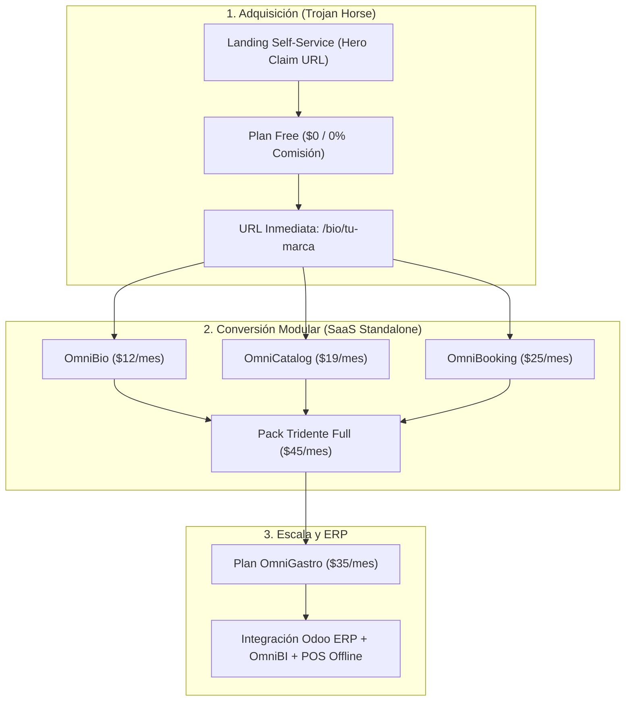

# Informe de Evaluación del Estado del Arte — Estratega Comercial y Microservicios

> **Módulo:** `docs/plans/estratega-comercial-microservicios/`  
> **Fecha:** 12 de Noviembre de 2026  
> **Versión del Sistema:** v1.46.4  
> **Referencia de Commits:** `01637f7` (auditoría y plan del tridente), `36f690f` (informe del estado del arte) y `185cf2b` (migración pnpm y troubleshooting 219/220)  
> **Autor/Evaluación:** Antigravity / Ecosistema OmniFlow

---

## 1. Resumen Ejecutivo y Diagnóstico Global

La estrategia de desacoplamiento de microservicios y comercialización (*Estratega
Comercial*) maduró desde un planteamiento teórico hacia un **modelo de negocio ejecutable
respaldado por infraestructura validada**.

La última actualización incorporó dos piezas fundamentales:

1. **Auditoría UX/UI de la Landing Page** (`informe-evaluacion-landing-omniflow-feat195.md`):
   diagnóstico empírico sobre `https://orderflow.pesallaccia.com/`. La medición original
   fue **pre-deploy (1.40.2)**; la re-evaluación post-deploy (1.46.3) confirma que el
   claim de URL, la tabla de precios y el showcase de Provecchio ya están implementados y
   publicados.
2. **Plan Comercial Integrado del Tridente**
   (`plan-comercial-tridente-omnibio-omnicatalog-omnibooking.md`): propuesta de valor
   modular (OmniBio, OmniCatalog y OmniBooking), matriz tarifaria canónica y modelo de
   captura *Trojan Horse*.



---

## 2. Semáforo de Madurez por Componente

| Componente | Estado | Nivel de Madurez | Resumen Técnico / Situación Actual |
| :--- | :---: | :---: | :--- |
| **Monorepo & DevOps (pnpm)** | 🟢 | **95%** (fase 1 completada) | Reducción de ~4.2 GB a ~1.7 GB mediante `pnpm 10.34.9`. Validado en staging y local (1061/1061 Jest). |
| **Estrategia Comercial Tridente** | 🟢 | **90%** (formalizada) | Paquetización clara: precios individuales vs pack integral vs Enterprise. |
| **Esquema de URLs Free vs Pro** | 🟢 | **90%** (especificado) | Free por path (`/bio/<slug>`) sin costo DNS/SSL vs Pro por subdominio (`<slug>.pesallaccia.com`). |
| **Landing Page Desktop** | 🟢 | **95%** (implementada) | Claim de URL, tabla de precios Free/Pro/OmniGastro y showcase de Provecchio publicados en 1.46.3. Falta la explicación narrativa del esquema de URLs. |
| **Landing Page Mobile-First** | 🟡 | **60%** (medido en 1.46.3) | Medición en vivo a 375 px: 6.6/10. Header 480/360, comparativa 526/319 y tabla de precios con celdas de 65–103 px. |
| **Onboarding Express 60s** | 🟡 | **80%** (prefill corregido en 1.46.4) | `registerTenant` instala `biolinks` + `social-catalog` y crea el BioLink. El claim envía `?storeName=` y el campo se prellena desde 1.46.4 (pendiente de deploy). Falta devolver el slug y redirigir a `/bio/<slug>`. |
| **Cumplimiento Regla #10 (Diseño)** | 🟢 | **85%** (casi completo) | Gradientes migrados a tokens del tema; quedan 2 sombras `rgba(0,0,0,…)` hardcodeadas. |

---

## 3. Evaluación Detallada por Dimensión

### 3.1 Dimensión de Negocio: El Tridente y la Matriz de Precios

- **Propuesta desacoplada:** se ratifica la independencia funcional de los tres pilares:
  - **OmniBio:** perfil dinámico de enlaces y branding personal/comercial.
  - **OmniCatalog:** catálogo interactivo con checkout directo vía WhatsApp.
  - **OmniBooking:** agendamiento y citas online para servicios o mesas.
- **Modelo de entrada sin fricción:** la URL por path compartido
  (`orderflow.pesallaccia.com/bio/<slug>`) elimina barreras técnicas (cero propagación
  DNS, cero certificados SSL dinámicos, cero peticiones a la API de Cloudflare),
  permitiendo aprovisionar tenants en 60 segundos con costo marginal cero.
- **Matriz tarifaria canónica** (detalle y regla de reconciliación en
  `plan-comercial-tridente-omnibio-omnicatalog-omnibooking.md`):
  - **Free Forever:** $0 (catálogo básico, 0% comisiones, marca de agua).
  - **Pro Emprendedor:** $15/mes (subdominio propio, productos ilimitados,
    **OmniBooking Lite**: 1 agenda sin cobros, sin marca de agua).
  - **OmniGastro:** $35/mes (KDS, POS offline, delivery GPS, SIFEN/DNIT, dominio propio).
  - **OmniBio Standalone:** $12/mes ($9/mes anual).
  - **OmniCatalog Standalone:** $19/mes ($15/mes anual).
  - **OmniBooking Standalone:** $25/mes ($20/mes anual; hasta 3 agendas y cobros).
  - **Pack Tridente Full:** $45/mes ($35/mes anual).

> **Reconciliación:** el plan Pro ($15) incluye OmniBooking **Lite** (1 agenda, sin
> cobros); el módulo OmniBooking Standalone ($25) incluye la versión completa. Así se evita
> el arbitraje de comprar Pro para obtener un OmniBooking completo más barato.

### 3.2 Dimensión de Arquitectura y DevOps: Monorepo y Modo Dual

- **Optimización de almacenamiento (FEAT-212):**
  - Se superó la barrera de los ~4.2 GB de `node_modules` redundantes, alcanzando
    **~1.7 GB** en checkout fresco mediante `pnpm-workspace.yaml` y `.npmrc`
    (`node-linker=isolated`).
  - Se introdujo `scripts/fix-pnpm-links.sh` para corregir idempotentemente symlinks de
    distinta profundidad en pnpm 10.
  - Se declararon dependencias fantasma con cero drift (`socket.io`, `cron`, `dayjs`,
    `express`).
- **Aislamiento Standalone vs Enterprise:**
  - ⚠️ **Propuesta, no implementada:** a v1.46.3 no existe el flag `STANDALONE_MODE` ni un
    `SyncModule` condicional en el código. El diseño objetivo está en
    `02-arquitectura-standalone-vs-enterprise.md`; hoy solo existe
    `services/sync-standalone` como microservicio independiente.
  - **Restricción Prisma documentada:** el aislamiento de pnpm impone un único slot físico
    para `@prisma/client`. `omnibi-standalone` ya implementó el patrón de resolución
    directa (`@prisma/omnibi-client`), sirviendo de modelo para los **8 servicios
    restantes** en la fase 2 de pnpm.

### 3.3 Dimensión Frontend y Conversión: Auditoría Landing FEAT-195

La re-evaluación post-deploy sobre `https://orderflow.pesallaccia.com/` (1.46.3) confirma:

1. **Implementado y publicado:**
   - Hero con claim de URL (`/bio/[slug]` + placeholder `tu-marca`).
   - Tabla de precios Free / Pro / OmniGastro.
   - Showcase de Provecchio y demo interactiva.
   - Claim encadenado al registro (`?storeName=`), con prefill corregido en 1.46.4 (pendiente de deploy).
   - Auto-instalación de `biolinks` + `social-catalog` en `registerTenant`.
2. **Pendiente:**
   - ~~Prefill de `storeName` en el registro~~ ✅ Corregido en 1.46.4 (pendiente de
     deploy); causa raíz y fix en el informe de evaluación §4.3 y troubleshooting #221.
   - Fricciones mobile confirmadas en vivo (375 px): header 480/360, tabla comparativa
     526/319 y tabla de precios con celdas de 65–103 px.
   - Redirect post-registro a `/bio/<slug>` (hoy navega a `/admin`).
   - Upsell de módulos standalone del Tridente en la landing.
   - Explicación narrativa del esquema Free (path) vs Pro (subdominio).
   - 2 sombras `rgba(0,0,0,…)` hardcodeadas (Regla #10).

---

## 4. Matriz de Gaps y Priorización

```
┌────────────────────────────────────────────────────────────────────────┐
│                              PRIORIDAD P0                              │
│  - ✅ Prefill de storeName corregido en 1.46.4 (pendiente de deploy).   │
│  - Re-verificar y corregir header y CTAs truncados en móvil.           │
│  - Tabla de precios y comparativa: cards apiladas en mobile.           │
├────────────────────────────────────────────────────────────────────────┤
│                              PRIORIDAD P1                              │
│  - Redirect post-registro directo a /bio/{slug}.                       │
│  - Explicar el esquema Free (path) vs Pro (subdominio).                │
│  - Publicar upsell de módulos standalone del Tridente.                 │
├────────────────────────────────────────────────────────────────────────┤
│                              PRIORIDAD P2                              │
│  - Reemplazar las 2 sombras rgba() por tokens (Regla #10).             │
│  - Migrar los 8 microservicios restantes al patrón @prisma/<svc>-client│
│  - Fase 2 de pnpm: CI, Docker y lockfiles.                             │
└────────────────────────────────────────────────────────────────────────┘
```

---

## 5. Plan de Acción Recomendado (Roadmap de 3 Sprints)

### Sprint 1: Mobile Polish & Re-verificación (Frontend)

- **Objetivo:** llevar la landing de 6.6 (mobile, medido en 1.46.3) a ≥8.5 en viewport 375–390 px.
- **Acciones:**
  1. Rediseñar el header sticky (logo + CTA corto o menú hamburguesa).
  2. Transformar la tabla de precios y la comparativa en cards apiladas en móvil.
  3. Acortar textos de CTA en mobile.
  4. Re-medir sobre 1.46.3 y documentar el resultado.

### Sprint 2: Onboarding Express End-to-End (Fullstack)

- **Objetivo:** reducir el alta del comercio a menos de 60 segundos reales.
- **Acciones:**
  1. ~~Corregir el prefill de `storeName` en `frontend/src/pages/login.tsx`~~ ✅ Hecho en
     1.46.4 (ver informe §4.3); queda desplegarlo.
  2. Devolver el `slug` generado en `registerTenant` (`backend/src/auth/auth.service.ts`).
  3. Consumir el slug en `frontend/src/pages/login.tsx` y redirigir a `/bio/<slug>`.
  4. Verificar el flujo completo: Hero → registro → catálogo público.

### Sprint 3: Calidad, Tokens y Fase 2 de Microservicios

- **Objetivo:** paridad técnica con los estándares del proyecto (AGENTS.md).
- **Acciones:**
  1. Reemplazar las 2 sombras `rgba()` por tokens de Ant Design (Regla #10).
  2. Adoptar el patrón `@prisma/<service>-client` en los 8 microservicios restantes.
  3. Migrar CI/Docker a pnpm (fase 2) y actualizar lockfiles.
  4. Mantener la documentación sincronizada con la wiki (`orderflow/docs/` y espejo
     `docs/`).

---

## 6. Índice de Archivos del Módulo

| Archivo | Rol en la Suite |
| :--- | :--- |
| `01-desacoplamiento-y-comercializacion.md` | Visión global y arquitectura progresiva en 3 fases. |
| `02-arquitectura-standalone-vs-enterprise.md` | Especificación **propuesta** de modos de ejecución (`STANDALONE_MODE`); no implementada. |
| `03-optimizacion-monorepo-pnpm.md` | Resultados de la migración pnpm fase 1, symlinks y métricas de disco. |
| `estudio-de-caso-pency.md` | Brief de benchmarking competitivo frente a Linktree, Pency y Agendit. |
| `plan-feat-195-landing-self-service-y-esquema-free.md` | Plan de implementación de landing unificada y URLs Free/Pro. |
| `plan-comercial-tridente-omnibio-omnicatalog-omnibooking.md` | Propuesta de valor, precios standalone, packs y GTM. |
| `informe-evaluacion-landing-omniflow-feat195.md` | Auditoría UX/UI de la landing: medición pre-deploy y re-evaluación 1.46.3. |
| **`informe-estado-del-arte-estratega-comercial.md`** | **Este documento:** síntesis ejecutiva y evaluación de madurez consolidada. |
