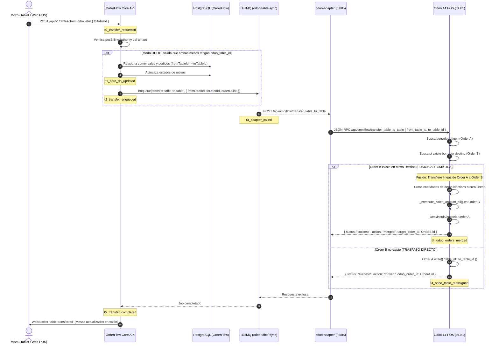

# Plan Maestro: Integración Odoo POS, Catálogo Bidireccional y Hub de Auditoría

> **Módulo:** Integraciones / Odoo Adapter / OmniGastro POS  
> **Fecha de Actualización:** 2026-10-25  
> **Estado:** 📋 Especificación Técnica & Plan de Actualización  
> **Ambientes de Referencia:** Producción Provecchio (`dimoraserverlocal` 192.168.69.240) y Odoo 14 CE (`192.168.69.246:/opt/odoo/`)

---

## 1. Visión & Principios de Diseño

1. **Amoldarse a Odoo en Modo Cobro:** Cuando Odoo es la autoridad del POS, OrderFlow suple la interfaz táctil/QR del mozo y salón, pero se ciñe 100% a las reglas y limitaciones de Odoo (restringiendo cualquier operativa local incompatible).
2. **Selector de Autoridad del POS (`posBillingAuthority`):**
   * **Modo `ODOO`:** Cobro en caja física de Odoo, cierre de mesa vía `pos.order`, validación estricta de mapeo de mesas (`restaurant.table`), y traspaso de mesas con fusión automática de comandas.
   * **Modo `ORDERFLOW`:** Cobro directo en OrderFlow (con módulo `bills`, Facturasend fiscal, split-bills y pasarelas de pago independientes).
3. **Catálogo con Auditoría e Igualación Bidireccional:**
   * Odoo es la fuente predeterminada para costos PMP y precios de lista.
   * Soporte de sobreescritura bidireccional (Push / Pull), idéntico al mecanismo de contactos/usuarios.
   * **Panel de Auditoría de Inconsistencias:** Vista comparativa campo a campo (precios, costos, stock, nombres, categorías) donde el usuario audita las diferencias, elige la fuente de la verdad (Odoo u OrderFlow) e iguala los datos automáticamente.

---

## 2. Arquitectura de Componentes

```
┌────────────────────────────────────────────────────────────────────────┐
│                        ORDERFLOW FRONTEND (ADMIN)                      │
│                                                                        │
│   [ Hub Integraciones Odoo ]                                           │
│   ├── Selector Autoridad POS: [ Odoo POS  ▼ ]                          │
│   ├── Tab 1: Usuarios & Mozos (res.users / hr.employee)                │
│   ├── Tab 2: Salón & Mesas (Mapeo, Sesiones TPV, Políticas Traspaso)   │
│   ├── Tab 3: Categorías (product.category / pos.category)              │
│   └── Tab 4: Auditoría de Catálogo & Inconsistencias (Diff + Igualar)   │
└────────────────────────────────────────────────────────────────────────┘
                                    │
                  REST API / WebSockets (NestJS Core)
                                    ▼
┌────────────────────────────────────────────────────────────────────────┐
│                        ORDERFLOW CORE BACKEND                          │
│                                                                        │
│   ├── IntegrationsService / OdooCatalogSyncService                     │
│   │   ├── auditProducts(tenantId) -> { synced, diffs, missing }        │
│   │   └── reconcileProducts(tenantId, { strategy, items })             │
│   ├── TablesService (transferTable con guards de autoridad)            │
│   └── BullMQ Queues: odoo-table-sync / odoo-catalog-sync               │
└────────────────────────────────────────────────────────────────────────┘
                                    │
                      HTTP REST (odoo-adapter:3005)
                                    ▼
┌────────────────────────────────────────────────────────────────────────┐
│                        ODOO ADAPTER & ADDON                            │
│                                                                        │
│   ├── odoo-adapter (Express)                                           │
│   │   ├── POST /api/omniflow/transfer_table_to_table (con auto-merge)  │
│   │   ├── POST /sync/pos-categories/fetch (pos.category)               │
│   │   └── POST /sync/products/reconcile                                │
│   └── pos_omniflow_sync (Odoo 14 CE Addon en :8081)                    │
│       ├── transfer_table_to_table (fusión de líneas en borrador Odoo)  │
│       └── pos.order compatible reference sanitizer                     │
└────────────────────────────────────────────────────────────────────────┘
```

---

## 3. Especificación Detallada de Módulos

### 3.1 Selector de Autoridad de Cobro y Restricciones Operativas

En la configuración del tenant (`Tenant.config.gastro.posBillingAuthority`):

| Característica | Modo `ODOO` (Restricción TPV Odoo) | Modo `ORDERFLOW` (POS Nativo) |
|---|---|---|
| **Cobro y Facturación** | Exclusivo en la caja/TPV de Odoo. En OrderFlow solo se permite "Solicitar Cuenta" / "Cerrar para Cobro en Caja". | Permitido cobro directo, Facturasend, división de cuenta en mesa. |
| **Mapeo de Mesas** | Obligatorio: toda comanda exige `restaurant_tables.odoo_table_id`. Si falta mapeo, bloquea el envío a cocina. | Opcional: no requiere vínculo con Odoo. |
| **Traspaso de Mesas** | Ejecuta fusión automática en Odoo (`transfer_table_to_table`). | Reasignación interna de órdenes y comensales en PostgreSQL. |
| **Sesión POS Requerida** | Exige sesión TPV abierta (`pos.session` `state='opened'`). Si la caja está cerrada, alerta al mozo. | No depende de sesiones externas. |

---

### 3.2 Flujo: Intercambio y Traspaso de Mesas con Fusión en Odoo (Diagram-Driven)



#### Hitos de Telemetría (Regla 13)
* `t0_transfer_requested`: Mozo confirma el traspaso en la interfaz.
* `t1_core_db_updated`: PostgreSQL actualiza `orders` y `table_guests`.
* `t2_transfer_enqueued`: Job encolado en Redis BullMQ con payload normalizado.
* `t3_adapter_called`: Adapter autentica y despacha la petición al controlador Odoo.
* `t4_odoo_table_reassigned` / `t4_odoo_orders_merged`: Odoo realiza la fusión o cambio de mesa en la base `prod`.
* `t5_transfer_completed`: Notificación en tiempo real a todas las pantallas de salón y KDS.

---

### 3.3 Categorías: Jerarquías Duales (`product.category` y `pos.category`)

1. **Categorías Internas / Contables (`product.category`):**
   * Usadas para costeo, inventario y cuentas contables.
   * Se mapean al campo `odooProductCategoryId` en `ProductCategory`.
2. **Categorías del TPV (`pos.category`):**
   * Usadas para la visualización táctil del mozo en el salón (con `sequence`, iconos y ordenación).
   * Se agregan a `odoo-client.js`: `getPosCategories()` consultando `pos.category` con `['id', 'name', 'parent_id', 'sequence']`.
   * Se mapean al campo `odooPosCategoryId` en `ProductCategory`.
   * En la tabla `products`, `posCategoryId` queda vinculado a la categoría TPV sincronizada.

---

### 3.4 Catálogo de Productos: Panel de Auditoría e Igualación Bidireccional

#### Matriz de Campos Comparados
* Clave de conciliación: `skuInterno` ↔ `default_code` (o `barcode` si no hay SKU).
* Atributos comparados:
  * **Nombre:** `Product.name` vs `product.product.name`
  * **Precio Venta:** `Product.price` vs `list_price`
  * **Costo Compra / PMP:** `Product.costPricePmp` vs `standard_price`
  * **Stock Físico:** `Product.stockAvailable` vs `qty_available`
  * **Categoría POS:** `Product.posCategoryId` vs `pos_categ_id`
  * **Activo:** `Product.active` vs `active`

#### Estados de Auditoría
1. 🟢 **Sincronizados (Synced):** Valores idénticos en ambos sistemas.
2. 🟡 **Inconsistencia Detectada (Conflict):** Existe en ambos pero difiere algún valor (ej. Precio OF: 45.000 vs Odoo: 50.000).
3. 🔵 **Solo en OrderFlow (Missing in Odoo):** Creado localmente; opción de enviarlo (`Push to Odoo`).
4. 🟣 **Solo en Odoo (Missing in OrderFlow):** Creado en el ERP; opción de traerlo (`Pull to OrderFlow`).

#### Acciones de Igualación (Reconciliation Engine)
* **`Igualar Todo desde Odoo` (Bulk Pull):** Sobrescribe precios de venta, costos PMP, categorías y stock en OrderFlow adoptando Odoo como fuente de verdad.
* **`Igualar Todo hacia Odoo` (Bulk Push):** Envía productos y modificaciones de OrderFlow hacia Odoo vía XML-RPC.
* **`Igualación Granular por Fila`:** Selector interactivo donde el usuario decide fila por fila:
  * `[ ← Traer de Odoo ]`
  * `[ Enviar a Odoo → ]`

---

## 4. Estructura de la Interfaz: Hub de Integración (`integrations.tsx`)

El frontend de integración se divide en 4 vistas especializadas:

1. **Ajustes Generales & Modo de Operación:**
   * Selector: *Autoridad de Cobro del POS* (`[ Odoo 14 POS ]` / `[ OrderFlow POS Nativo ]`).
   * Configuración de conexión (Host, puerto, DB, usuario).
   * Test de conexión y estado de salud.
2. **Salón, Mesas & Traspasos:**
   * Lista de mesas vinculadas vs huérfanas.
   * Detección de sesiones POS activas en Odoo.
   * Política de traspaso: *Fusión automática activa*.
3. **Categorías (Internas & PDV):**
   * Árbol de categorías de productos y categorías de TPV.
   * Botón de sincronización jerárquica con un clic.
4. **Auditoría de Inconsistencias de Catálogo:**
   * KPIs en cabecera: Total auditados, En sincronía, Con diferencias, Nuevos en Odoo, Nuevos en OF.
   * Tabla con resaltado visual de diferencias (utilizando tokens de Ant Design `colorWarningBg`, `colorErrorBg`, etc. sin colores hex hardcodeados).
   * Botones de acción masiva e individual.

---

## 5. Plan de Ejecución por Fases

| Fase | Tarea | Componentes Afectados | Entregables |
| :---: | :--- | :--- | :--- |
| **1** | **POS Traspaso & Fusión en Odoo** | Addon `pos_omniflow_sync`, `odoo-adapter`, `tables.service.ts`, `odoo-table-sync.listener.ts` | Endpoint `/api/omniflow/transfer_table_to_table`, fusión de comandas en Odoo y tests. |
| **2** | **Selector de Autoridad POS** | Backend guards, frontend `integrations.tsx`, `gastro.tsx` | Switch de autoridad `ODOO` / `ORDERFLOW`, bloqueo defensivo de mesas no vinculadas. |
| **3** | **Categorías PDV (`pos.category`)** | `odoo-client.js`, `integrations.service.ts` | Extracción y persistencia del árbol de categorías TPV. |
| **4** | **Motor de Auditoría de Catálogo** | `odoo-catalog-sync.service.ts`, endpoints de diff | Algoritmo de comparación por SKU/barcode y detección de discrepancias. |
| **5** | **UI de Auditoría e Igualación** | `integrations.tsx`, componentes de diff | Pestaña de auditoría con botones Pull/Push masivos y granulares. |
| **6** | **Pruebas E2E & Validación en Producción** | Playwright E2E, scripts de verificación | Tests automatizados de traspaso de mesa y reconciliación de catálogo en laboratorio Provecchio. |

---

## 6. Próximo Paso Inmediato

¿Deseas que iniciemos con la **Fase 1 (Traspaso de mesas con fusión automática en el Addon Odoo y Adapter)** para resolver operativamente el flujo del salón?
