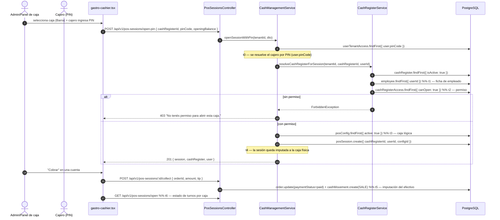

# Auditoría FEAT-193 — Cobro centralizado multi-caja: la sesión se ancla a la caja física

**Fecha:** 2026-10-21 · **Versión:** v1.39.18 · **Rama:** `fix/gastro-cash-session-cash-register`
**Tenant de referencia:** `provecchio-dimora-001` (provecchio.com)

---

## 1. Contexto

Con las 4 cajas ya configuradas en producción (Caja Principal, Barra, Terraza, Caja Auxiliar) y sus
10 accesos por cajero (`cash_register_access`), se quiso cerrar el circuito del **cobro
centralizado multi-caja**: que la cuenta cobrada en la barra se impute a la caja "Barra" y que el
arqueo de cada caja sea independiente.

Al verificar el flujo contra producción se descubrió que **la sesión de caja nunca se anclaba a una
caja física** y que **el panel de caja no funcionaba**.

### 1.1 Estado real de los datos (verificado en prod y local)

| Concepto | Tabla | Registros |
|---|---|---|
| Caja lógica de sesión (terminal POS) | `pos_configs` | **1** — "Caja Principal" (`CP-001`) |
| Puntos de cobro físicos | `cash_registers` | 4 — Principal, Barra, Terraza, Auxiliar |
| Quién abre/cierra qué caja | `cash_register_access` | 10 |
| Sesión → caja física | `pos_sessions.cash_register_id` | **siempre `null`** |

> Es decir: había **una sola caja lógica** y lo que rotaba era el cajero por sesión. Las 4 cajas
> físicas existían como catálogo y control de acceso, pero ninguna sesión se|linkaba a ellas.

---

## 2. Diagnóstico: 3 defectos independientes

| # | Síntoma | Causa raíz | Archivo |
|---|---|---|---|
| **1** | El panel de caja no cargaba sesión ni cobraba: `404` | El frontend llamaba `/api/v1/pos/sessions/{active,open-pin,:id/collect}`; los endpoints reales viven en `/api/v1/pos-sessions/*` | `frontend/src/pages/admin/gastro-cashier.tsx:115,149,189` |
| **2** | `404 "Configuración de caja no encontrada"` al abrir con PIN | El frontend mandaba `configId` con el **id de la `cash_register`**, pero el backend lo busca en `pos_configs` | `frontend/src/pages/admin/gastro-cashier.tsx:150` vs `backend/src/pos/cash-management.service.ts:95` |
| **3** | El cobro no se podía imputar a una caja concreta | Ni `openSession` ni `openSessionWithPin` aceptaban `cashRegisterId` → `pos_sessions.cash_register_id` nunca se escribía | `backend/src/pos/cash-management.service.ts`, `backend/src/pos-sessions/pos-sessions.service.ts` |

Prueba de los tres (localhost, v1.39.17):

```
GET  /api/v1/pos/sessions/active   -> 404
GET  /api/v1/pos-sessions/active   -> 200
POST /api/v1/pos-sessions/open-pin  { configId: <id cash_register> }  -> 404 "Configuración de caja no encontrada"
POST /api/v1/pos-sessions/open-pin  { configId: <id pos_config>   }  -> 201 (cashRegisterId: null)
```

---

## 3. Solución implementada

### 3.1 Backend

**`backend/src/pos/cash-management.service.ts`**
- `OpenSessionPinDto`: `configId` pasa a **opcional** (si no llega se resuelve el `pos_config` activo
  del tenant) y se agrega `cashRegisterId` **opcional**.
- `openSessionWithPin()`: resuelve la caja física, valida el acceso del cajero y guarda la sesión con
  `cash_register_id`. La respuesta ya **no expone el `pinCode`** del cajero.

**`backend/src/pos/cash-register.service.ts`**
- Nuevo `resolveCashRegisterForSession(tenantId, cashRegisterId, userId)`:
  1. la caja debe existir y estar `isActive`;
  2. el cajero debe tener **ficha de empleado** (`employees.user_id`);
  3. debe existir un `cash_register_access` con `can_open = true`;
  4. si no → `403 "No tenés permiso para abrir esta caja."`.

**`backend/src/pos-sessions/pos-sessions.service.ts`**
- `openSession()` acepta `cashRegisterId` y ancla la sesión.
- `getActiveSession(tenantId, userId, cashRegisterId?)`: si se pasa `cashRegisterId` devuelve la
  sesión abierta de esa caja (no la del usuario autenticado).
- Nuevo `getOpenSessions(tenantId)`: lista las sesiones abiertas del tenant con su caja y su cajero.

**`backend/src/pos-sessions/pos-sessions.controller.ts`**
- `GET /api/v1/pos-sessions/open` (nuevo).
- `GET /api/v1/pos-sessions/active?cashRegisterId=...` (query opcional).

### 3.2 Frontend (`frontend/src/pages/admin/gastro-cashier.tsx`)

- Rutas corregidas a `/api/v1/pos-sessions/*`.
- El `open-pin` manda `cashRegisterId` (la caja elegida) y ya no manda `configId`.
- El selector de caja es **siempre visible**; muestra "· abierta" en las cajas con turno abierto.
- Banner verde: cajero, hora de apertura y fondo inicial de la caja seleccionada.
- Banner de "cajas con turno abierto" con el cajero de cada una (recupera el turno tras recargar).
- Todos los colores salen de `theme.useToken()` (Regla #10 de AGENTS.md).

### 3.3 Contratos REST

```http
POST /api/v1/pos-sessions/open-pin
Authorization: Bearer <jwt>            (o x-api-key)
x-tenant-id: provecchio-dimora-001     (opcional si el JWT trae el tenant)

{
  "cashRegisterId": "062ec9af-7ef7-491e-814a-a921ceb97a7d",  # opcional
  "pinCode": "1234",
  "openingBalance": 0,
  "deviceLabel": "Web Admin"
}

201 Created
{
  "id": "…", "state": "OPENED",
  "configId": "d93d03bd-…",              # pos_config activo
  "cashRegisterId": "062ec9af-…",        # caja física (nuevo)
  "cashRegister": { "id": "…", "name": "Barra", "code": "CASHIER_2", "location": "Barra" },
  "user": { "id": "…", "name": "Ninfa Lecoque", "email": "ninfa@provecchio.com" }
}

403 Forbidden  { "message": "No tenés permiso para abrir esta caja." }   # sin can_open
404 Not Found  { "message": "Caja registradora no encontrada." }          # caja inexistente/inactiva
```

```http
GET /api/v1/pos-sessions/open
200 OK  [ { "id": "…", "cashRegister": { "name": "Barra", … }, "user": { "name": "Ninfa Lecoque" }, … } ]
```

---

## 4. Diagrama de secuencia

> El diagrama canónico del flujo (con contratos REST y hitos de telemetría) vive en
> [`flujo_caja-fisica.md`](flujo-caja-fisica.md). Se reproduce aquí para que la auditoría sea
> autocontenida.



### Hitos de telemetría

| Hito | Momento | Dato persistido | KPI |
|---|---|---|---|
| `t0` | Resolución del cajero por PIN | `pos_sessions.userId` | % de aperturas con PIN correcto vs fallback admin |
| `t1` | Ficha de empleado del cajero | `employees.user_id` | Cajeros sin ficha (no pueden abrir caja) |
| `t2` | Permiso `can_open` en la caja | `cash_register_access` | Acces denegados por caja (top reasons) |
| `t3` | Resolución de la caja lógica | `pos_sessions.configId` | Terminales activas por tenant |
| `t4` | Imputación de la sesión a la caja | `pos_sessions.cash_register_id` | % de sesiones imputadas (objetivo 100 %) |
| `t5` | Imputación del efectivo | `cash_movements.pos_session_id` | Diferencia esperado vs real por caja |
| `t6` | Estado de turnos por caja | lectura de `pos_sessions` | Cajas abiertas simultáneas |

---

## 5. Validación

### 5.1 Unitarios — `backend/src/pos/cash-management.service.spec.ts` (13 casos)

| Caso | Resultado |
|---|---|
| PIN inválido / usuario inactivo | `400` ✅ |
| Cajero con sesión ya abierta | `400` ✅ |
| `configId` ausente → resuelve el `pos_config` activo | ✅ |
| `configId` de otro tenant | `404` ✅ |
| `cashRegisterId` válido → sesión anclada | ✅ |
| Sin `cashRegisterId` → sesión sin caja | ✅ |
| Permiso denegado (`can_open = false`) | `403` ✅ |
| Cajero sin ficha de empleado | `400` ✅ |
| Caja inexistente / inactiva | `404` ✅ |
| Cajero con `can_open = true` | ✅ |

### 5.2 E2E — `frontend/e2e/cashier-cash-register-flow.spec.ts` (3 casos)

| Caso | Qué valida |
|---|---|
| Listado de cajas | El Select del panel lista las cajas activas del tenant |
| Sesión anclada | Abrir con PIN en Barra deja la sesión con `cashRegisterId` = Barra |
| Permiso | Un cajero sin acceso a Barra recibe el error de permisos y no abre sesión |

### 5.3 Smoke manual (localhost y producción)

```
POST /api/v1/pos-sessions/open-pin { cashRegisterId: <Barra>, pinCode: "1234" }
  -> 201  cashRegisterId = 062ec9af-…  (Barra)   ✅ cajero con acceso
POST /api/v1/pos-sessions/open-pin { cashRegisterId: <Barra>, pinCode: "9012" }
  -> 403  "No tenés permiso para abrir esta caja."  ✅ cajero sin acceso
GET  /api/v1/pos-sessions/open -> 200 []  ✅
```

### 5.4 Barreras

- `tsc` backend y frontend sin errores (los errores de `tsc` en specs preexistentes son de antes de
  este cambio y no los introduce).
- `nest build` OK.
- Suite Jest completa en verde.
- `vite build` + PWA OK.

---

## 6. Sin migraciones

La columna `pos_sessions.cash_register_id` **ya existía** en el schema Prisma (y
`deleteCashRegister()` ya la anulaba con `updateMany`). El defecto era que ningún flujo la escribía.
No se creó ni se modificó ninguna tabla, por lo que no aplica la Regla §2.4 de migraciones.

---

## 7. Pendientes

| # | Pendiente | Responsable |
|---|---|---|
| 1 | Botón de **cierre de turno / arqueo Z por caja** en el panel (hoy el cierre es solo por API) | Ordenflow (FEAT-194) |
| 2 | **CI reales** de Giovanni y Giuliana (siguen `PLACEHOLDER-*`) | Cliente — `PUT /api/v1/hr/employees/:id { nationalId }` |
| 3 | Botón **"Crear caja"** en la UI (hoy solo por API `POST /api/v1/cash-registers`) | Ordenflow |
| 4 | Reporte de arqueo por caja (agrupar `cash_movements` por `cash_register_id`) | Ordenflow |
| 5 | Desplegar v1.39.18 en `provecchio.com` (con backup → restore local → validación) | Ordenflow |
