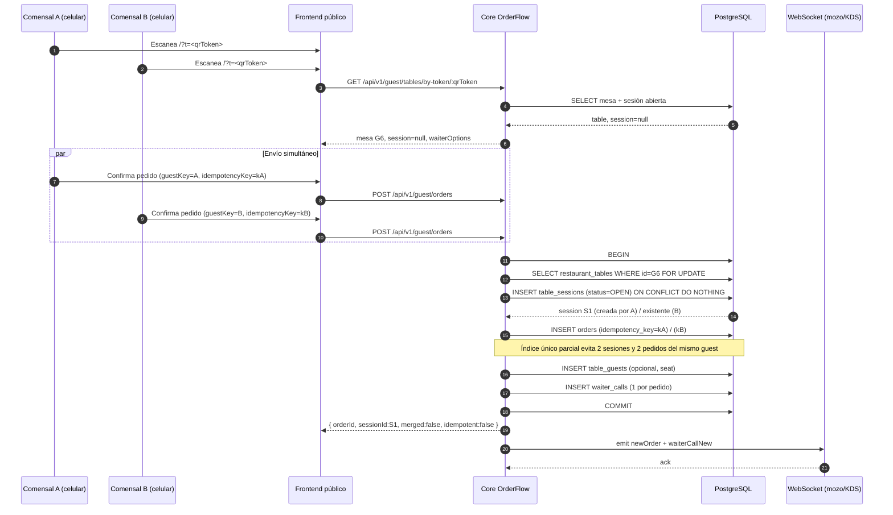
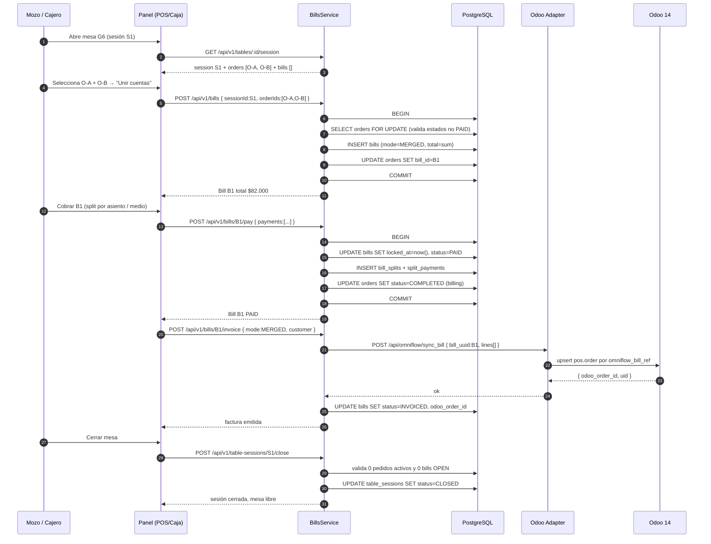
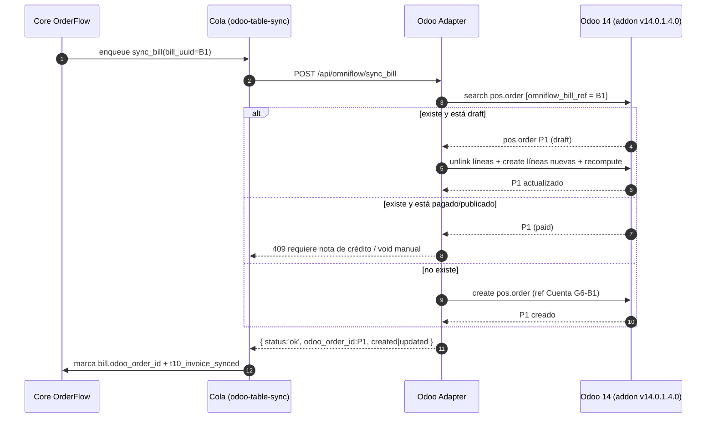
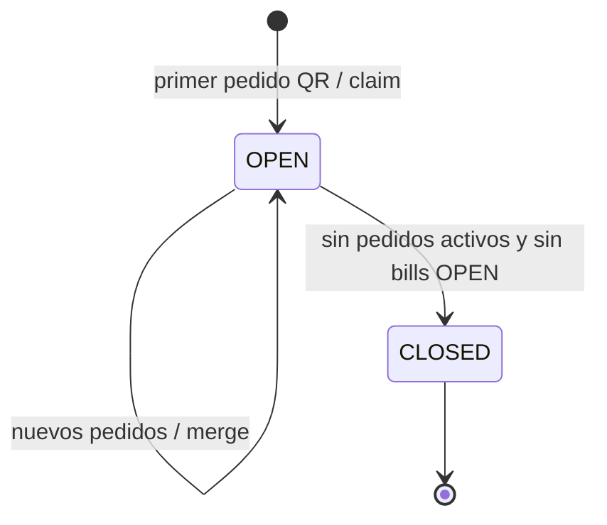
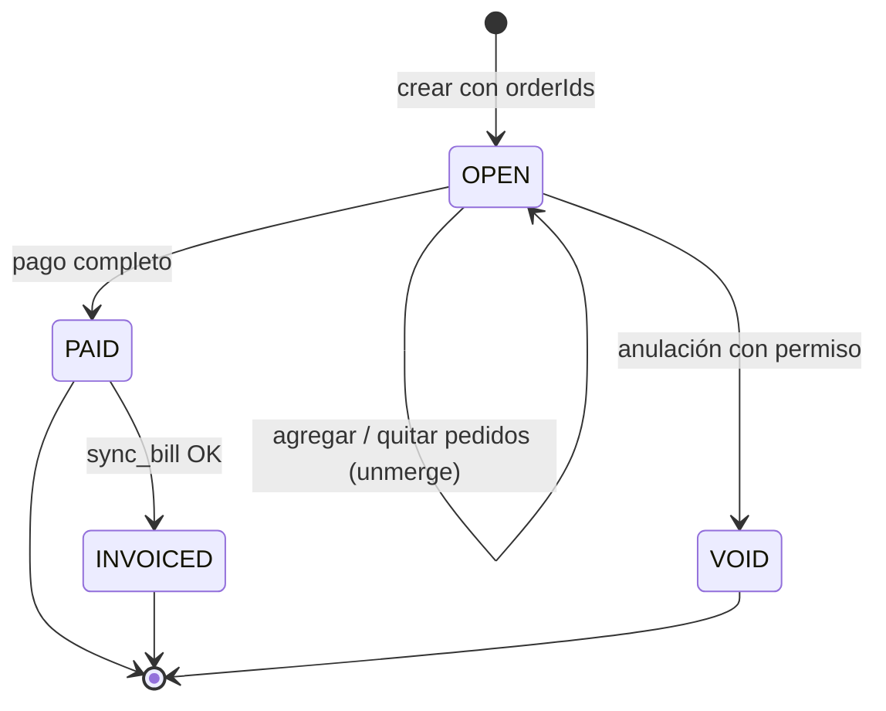
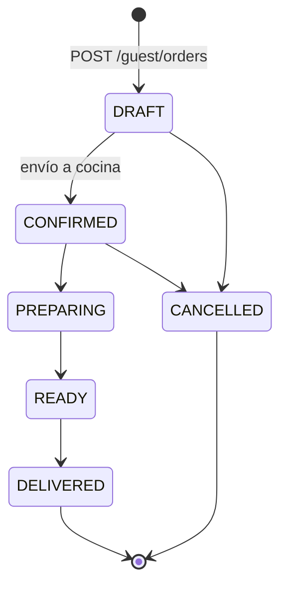
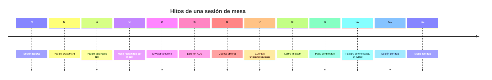

# Flujo — Cuentas de mesa y pedidos concurrentes (FEAT-203 / FEAT-204 / FEAT-205)

> **Vertical:** OmniGastro · **Versión objetivo:** 1.42.0 · **Estado:** 🟡 propuesto
> **Regla:** Diagram-Driven Development + Telemetry-First (AGENTS.md #13)
> **Plan maestro:** [`plan-actualizacion-cuentas-mesa-concurrentes.md`](./plan-actualizacion-cuentas-mesa-concurrentes.md)
> **Feature flag:** `gastro.tableSessions` (default `false`)

---

## 1. Objetivo

Agrupar los pedidos de una misma ocupación de mesa en una **sesión** (`TableSession`) y permitir
**unir / separar / cobrar cuentas** (`Bill`) sin perder trazabilidad ni duplicar ventas en Odoo.

El flujo cubre tres momentos:

1. **Alta concurrente por QR** — dos o más comensales piden a la vez desde el mismo token.
2. **Gestión y cobro** — el mozo o la caja agrupa pedidos en una cuenta, divide el pago y factura.
3. **Sincronización con Odoo** — una `pos.order` por cuenta facturada, idempotente.

---

## 2. Actores

| Actor | Rol |
|---|---|
| Comensal A / B | Escanea el QR de la mesa, envía su pedido desde el celular |
| Frontend público (`omni-catalog.tsx`) | Genera `guestKey` + `idempotencyKey`, bloquea doble envío |
| Core OrderFlow (`GuestOrdersController`, `TableSessionsService`, `BillsService`) | Resuelve sesión, valida, persiste, emite eventos |
| Mozo POS (`gastro-pos.tsx`) | Ve la mesa completa, reclama, agrega pedidos, une cuentas |
| Caja (`gastro-cashier.tsx`) | Agrupa/divide cuentas, cobra, factura |
| Odoo Adapter (`/api/omniflow/sync_bill`) | Traduce la cuenta a `pos.order` |
| Odoo 14 (`pos.order`, `pos.session`) | ERP; una orden por cuenta facturada |

---

## 3. Diagrama de secuencia — Alta concurrente por QR



**Resultado esperado:** `S1` con 2 pedidos (`O-A`, `O-B`), cada uno con su `guestKey`; un solo
`WaiterCall` por pedido; mesa en estado `OCCUPIED`.

---

## 4. Diagrama de secuencia — Unir cuentas y cobrar



---

## 5. Diagrama de secuencia — Sync Odoo idempotente (`sync_bill`)



---

## 6. Máquina de estados

### 6.1 Sesión de mesa



### 6.2 Cuenta (`Bill`)



### 6.3 Pedido (existente + vínculo)



---

## 7. Contratos REST (resumen)

### 7.1 Público

```http
GET /api/v1/guest/tables/by-token/:qrToken
→ 200 {
    table: { id, name, status },
    session: { id, status } | null,
    activeOrders: 2,
    waiterOptions: [{ id, label, icon }]
  }
```

```http
POST /api/v1/guest/orders
{
  "qrToken": "f9d120b7-...",
  "guestKey": "dev-8f3a...",
  "guestName": "Ana",            // opcional
  "seatNumber": 2,                // opcional
  "idempotencyKey": "c1a2...",    // UUID por envío
  "appendToOpenOrder": true,      // default true
  "lines": [{ "productId": "...", "quantity": 1, "notes": "" }]
}
→ 201 { orderId, sessionId, billId:null, merged:false, idempotent:false }
→ 200 (misma idempotencyKey) { orderId, idempotent:true }
→ 200 (append) { orderId, merged:true }
```

```http
GET /api/v1/guest/orders/:id
→ 200 { ...order, sessionId, billId, guestName }
```

### 7.2 Core (JWT)

| Método | Ruta | Cuerpo / Respuesta |
|---|---|---|
| `GET` | `/api/v1/tables/:tableId/session` | `{ session, orders[], bills[], totals }` |
| `POST` | `/api/v1/table-sessions/:id/claim` | `{ waiterId }` → 200 / 409 |
| `POST` | `/api/v1/table-sessions/:id/close` | → 200 / 409 con `blockers[]` |
| `GET` | `/api/v1/table-sessions/:id/bills` | `Bill[]` |
| `POST` | `/api/v1/bills` | `{ sessionId, orderIds[] }` → `Bill` |
| `POST` | `/api/v1/bills/:id/orders` | `{ orderIds[] }` → `Bill` |
| `POST` | `/api/v1/bills/:id/unmerge` | `{ orderIds[] }` → `Bill` nueva |
| `POST` | `/api/v1/bills/:id/pay` | `{ payments:[{method, amount, guestId?, tip?}] }` |
| `POST` | `/api/v1/bills/:id/invoice` | `{ mode, customerId?, taxId?, personName? }` |
| `GET` | `/api/v1/cashier/bills` | `[{ session, table, bills[], total }]` |

### 7.3 Adapter

```http
POST /api/omniflow/sync_bill
{
  "tenant_id": "...",
  "bill_uuid": "...",
  "odoo_config_id": 2,
  "odoo_table_id": 41,
  "mode": "MERGED",
  "customer": { "name": "...", "vat": "..." },
  "lines": [{ "product_odoo_id": 123, "qty": 2, "price_unit": 25000 }]
}
→ 200 { status:'ok', odoo_order_id, uid, created|updated }
→ 409 { status:'error', code:'POS_ORDER_LOCKED' }
```

---

## 8. Hitos de telemetría

| Hito | Evento canónico | Punto de emisión | Datos |
|---|---|---|---|
| t0 | `t0_session_opened` | `TableSessionsService.open` | `tenantId, tableId, sessionId, trigger` |
| t1 | `t1_order_created` | `GuestOrdersController.createDraft` | `orderId, sessionId, guestKey` |
| t2 | `t2_order_attached` | append a pedido existente | `orderId, sessionId, guestKey` |
| t3 | `t3_table_claimed` | claim de sesión | `sessionId, waiterId` |
| t4 | `t4_sent_to_kitchen` | envío a cocina | `orderId, kitchenTicketId` |
| t5 | `t5_ready` | KDS listo | `orderId, stationId` |
| t6 | `t6_bill_opened` | `BillsService.create` | `billId, sessionId, total, orderIds` |
| t7 | `t7_bill_merged` | merge/unmerge | `billId, orderIds, action` |
| t8 | `t8_payment_started` | inicio de cobro | `billId, method` |
| t9 | `t9_paid` | pago confirmado | `billId, total, payments` |
| t10 | `t10_invoice_synced` | `sync_bill` OK | `billId, odooOrderId, latencyMs` |
| t11 | `t11_session_closed` | cierre de sesión | `sessionId, closedBy` |
| t12 | `t12_table_freed` | mesa liberada | `tableId, sessionId` |

> **Compatibilidad:** `t0_order_created`, `t1_table_claimed` y `t11_table_closed` ya existen en
> `metadata.guestDraft`; se mantienen como alias hasta migrar los dashboards.

### 8.1 Diagrama de hitos



### 8.2 KPIs derivados

| KPI | Fórmula | Objetivo |
|---|---|---|
| Duplicados | `count(idempotent=true) / count(orders)` | < 0.1% |
| Pedidos por sesión | `orders / sessions` | 1.2–2.0 |
| Tasa de merge | `bills MERGED / bills` | según negocio |
| Huérfanos | `orders activos al cerrar sesión` | 0 |
| Latencia de sesión | `p95(t1 - t0)` | < 300 ms |
| Latencia de factura | `p95(t10 - t6)` | < 5 s |
| Errores de merge | `409+500 / intentos` | < 1% |

---

## 9. Casos de error y respuestas

| Caso | HTTP | Código | Acción del cliente |
|---|---|---|---|
| Dos mozos reclaman la mesa | 409 | `TABLE_ALREADY_CLAIMED` | Mostrar “Mesa tomada por X” |
| Merge de pedido ya pagado | 409 | `ORDER_ALREADY_BILLED` | Refrescar cuentas |
| Cierre con pedidos activos | 409 | `SESSION_HAS_OPEN_ORDERS` | Listar pedidos pendientes |
| Cierre con cuentas abiertas | 409 | `SESSION_HAS_OPEN_BILLS` | Ir a cobrar |
| Pago con suma ≠ total | 422 | `PAYMENT_AMOUNT_MISMATCH` | Ajustar montos |
| Sync Odoo sobre orden pagada | 409 | `POS_ORDER_LOCKED` | Nota de crédito manual |
| QR de mesa inexistente | 404 | `TABLE_NOT_FOUND` | Mensaje genérico |
| Doble envío (misma key) | 200 | `IDEMPOTENT_REPLAY` | Navegar al pedido existente |
| Sesión ya cerrada | 409 | `SESSION_CLOSED` | Recargar mesa |

---

## 10. Matriz de decisión del alta

| Sesión abierta | Pedido activo del `guestKey` | `appendToOpenOrder` | Resultado |
|---|---|---|---|
| No | — | — | Crear sesión + pedido |
| Sí | No | — | Crear pedido en la sesión |
| Sí | Sí | `true` | Agregar líneas al pedido existente (`t2`) |
| Sí | Sí | `false` | Crear pedido nuevo del mismo comensal |
| — | — | key repetida | Devolver pedido existente (`t1` idempotente) |

---

## 11. Verificación E2E mínima

1. Dos contextos Playwright con el mismo `qrToken` → envío simultáneo.
2. Assert: `GET /tables/:id/session` devuelve **una** sesión y **dos** pedidos.
3. Caja: unir ambos pedidos → **una** `Bill` con total correcto.
4. Pago completo → `Bill PAID`; segundo intento → 409.
5. `sync_bill` (mock o staging) → **una** `pos.order` con todas las líneas.
6. Cierre de sesión → `CLOSED`; mesa libre; historial del Mozo POS intacto (#198).
7. Telemetría: `t0…t12` presentes y en orden cronológico.
