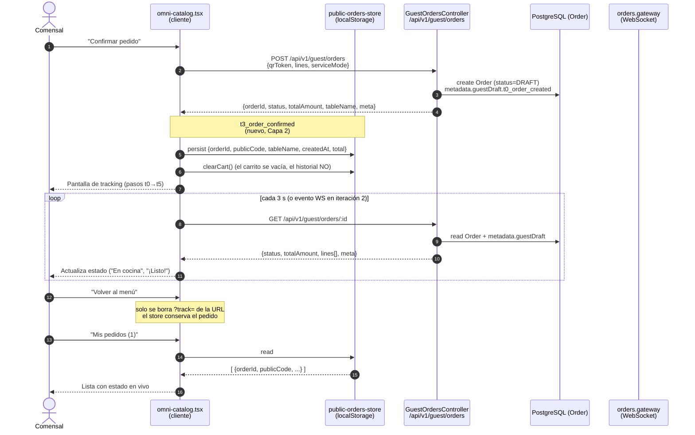
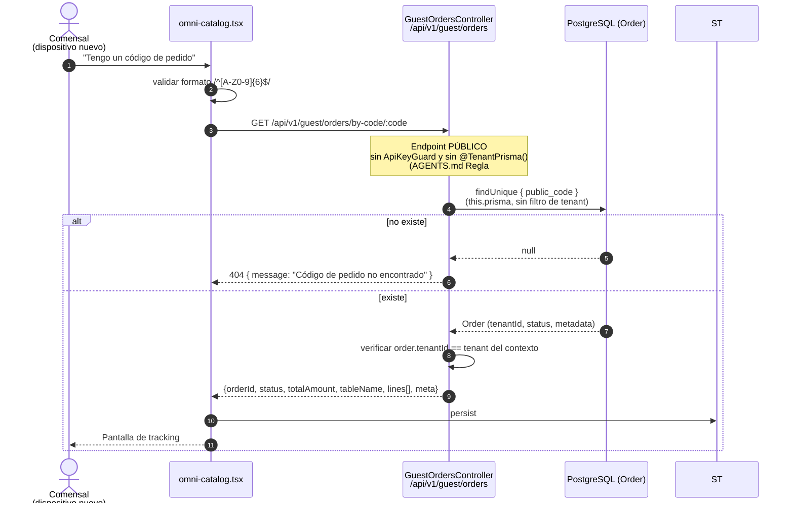
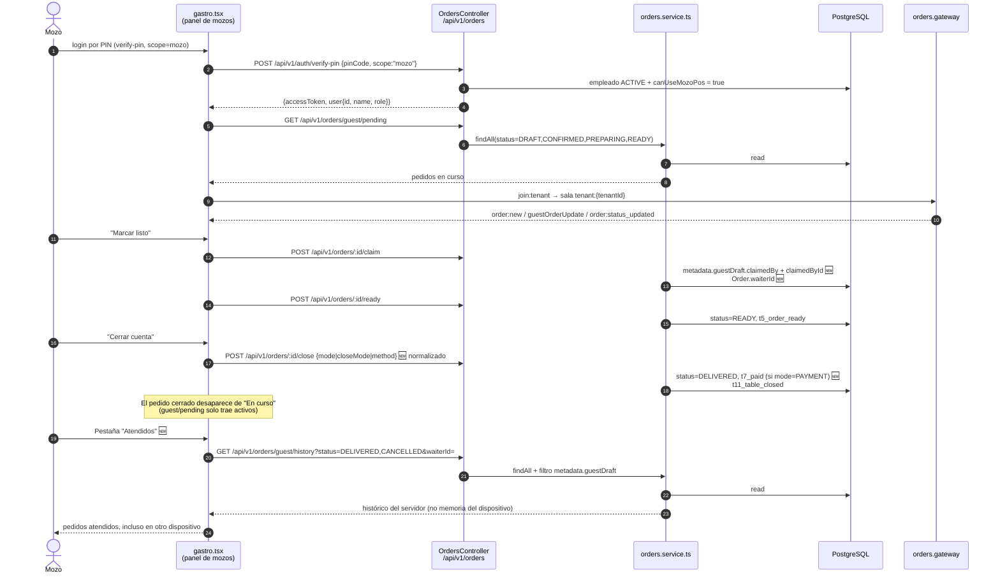

# Flujo · Historial y seguimiento de pedidos (cliente + panel de mozos)

> **Vertical:** OmniGastro · **Features:** FEAT-197 (Capa 1 → Capa 3) · **Versión objetivo:** v1.39.25 → v1.39.28
> **Plan maestro:** [`plan-actualizacion-v1.39.25-historial-pedidos-bandera-mozo.md`](./plan-actualizacion-v1.39.25-historial-pedidos-bandera-mozo.md)
> **Contrato REST declarado abajo es vinculante**: los nombres de los hitos de telemetría deben
> coincidir exactamente con los que se escriben en `Order.metadata.guestDraft`.

---

## 1. Actores y sistemas

| Actor | Descripción |
|---|---|
| **Comensal** | Cliente que pide desde la mesa con el QR (`?t=<qrToken>`) o desde un Bio-Link |
| **Mozo** | Empleado con la bandera `canUseMozoPos` (FEAT-194) que atiende la mesa en la tablet |
| **KDS** | Pantalla de cocina (`/admin/kds`), consume tickets |
| **Cajero** | Cobra la cuenta (`/admin/gastro/cashier`) |
| **Core OrderFlow** | Backend NestJS + Prisma/PostgreSQL + WebSocket (namespace `orders`) |
| **Navegador** | `localStorage` como caché local del historial del comensal |

---

## 2. Diagrama de secuencia — Capa 1: el comensal recupera su pedido

---

## 3. Diagrama de secuencia — Capa 2: recuperación desde otro dispositivo

---

## 4. Diagrama de secuencia — Capa 3: el mozo no pierde pedidos al cambiar de dispositivo

---

## 5. Contratos REST

| Método | Ruta | Guard | Descripción | Estado |
|---|---|---|---|---|
| `GET` | `/api/v1/guest/orders/:id` | público | Estado puntual de un pedido | ✅ existe |
| `GET` | `/api/v1/guest/orders/by-code/:code` | público | Pedido por código corto de 6 caracteres | 🆕 F3 |
| `GET` | `/api/v1/guest/orders/by-table/:tableId` | público | Pedidos **abiertos** de la mesa (opcional, iteración 2) | 🆕 F5 |
| `GET` | `/api/v1/orders/guest/pending` | `JwtAuthGuard` | Pedidos activos (en curso) | ✅ existe |
| `GET` | `/api/v1/orders/guest/history` | `JwtAuthGuard` | Histórico por mesa y/o mozo | 🆕 F4 |
| `GET` | `/api/v1/orders/kds/tickets` | `JwtAuthGuard` | Tickets del KDS (historial en servidor) | ✅ existe |
| `GET` | `/api/v1/users/mozo-staff` | `ApiKeyGuard` + `PermissionsGuard` | Empleados con `canUseMozoPos` | 🆕 F2 (FEAT-194) |
| `POST` | `/api/v1/auth/verify-pin` | `ApiKeyGuard` | PIN de mozo con `scope: "mozo"` | 🆕 F2 (FEAT-194) |

---

## 6. Hitos de telemetría (nomenclatura vinculante)

Se almacenan en `Order.metadata.guestDraft` (JSON). Los nombres **deben** coincidir con esta tabla.

| Hito | Momento | Campo actual | Estado |
|---|---|---|---|
| `t0_order_created` | El comensal confirma el pedido | `createdAt` | ✅ |
| `t1_table_claimed` | El mozo reclama el pedido | `claimedAt` | ✅ |
| `t2_cart_saved` | El comensal guarda el carrito | `cartSavedAt` | 🆕 F1 |
| `t3_order_confirmed` | El comensal confirma el pedido | `confirmedAt` | 🆕 F3 |
| `t4_sent_to_kitchen` | El pedido entra a cocina | `sentToKitchenAt` | ✅ |
| `t5_order_ready` | El pedido está listo | `readyAt` | ✅ |
| `t6_waiter_viewed_history` | El mozo abre el historial | evento `waiter_history_viewed` | 🆕 F4 |
| `t7_paid` | El pedido se cobra | `paidAt` | 🆕 F1 (FEAT-197-d) |
| `t11_table_closed` | La mesa se cierra | `closedAt` | ✅ |

### KPIs derivados

| KPI | Fórmula | Para qué sirve |
|---|---|---|
| Atención al pedido | `t4 − t0` | SLA de entrada a cocina |
| Preparación | `t5 − t4` | SLA de cocina |
| Ciclo completo | `t11 − t4` | SLA de mesa (cocina → cobro) |
| Abandono de carrito | pedidos con `t2` y sin `t3` | fricción del cliente |
| Uso del seguimiento | consultas a `by-code` + trackings polleados | adopción de la mejora |
| Continuidad del mozo | pedidos recuperados con `waiterId` en otro dispositivo | valor de la Capa 3 |

---

## 7. Eventos WebSocket潜移默izados

| Evento | Emisor | Campos | Consumidor previsto |
|---|---|---|---|
| `order:new` | `orders.gateway:66` | pedido completo | panel de mozos (`gastro.tsx:152`) |
| `guestOrderUpdate` | `orders.gateway:94` / `service` | `{orderId, meta}` (incluye `guestDraft` completo) | tracking del cliente (Capa 2, sustituye el polling) |
| `order:status_updated` | `orders.gateway:94` | `{orderId, status}` | KDS (`kds.tsx:182-206`) |
| `kds:ticket_new` | `orders.gateway:81` | ticket de cocina | KDS |
| `waiterCallNew` / `waiterCallUpdate` | `guest-call-waiter.controller.ts:74` / `waiter-calls.controller.ts:83` | llamada | panel de mozos, alertas del móvil |
| 🆕 `order:closed` | `orders.gateway` (a crear en F4) | `{orderId, tableId, waiterId}` | mover el pedido cerrado de "En curso" a "Atendidos" sin recargar |

---

## 8. Seguridad

| Regla | Aplicación |
|---|---|
| AGENTS.md §4 (endpoints públicos) | `by-code` **no** lleva `@TenantPrisma()` ni `ApiKeyGuard`; resuelve el tenant desde `Order.tenantId` con `this.prisma` |
| AGENTS.md §1 (tenantId sagrado) | Todo filtro de histórico incluye `tenantId` |
| Privacidad | El código corto se genera con `crypto.randomBytes` (no `Math.random`) y el listado por mesa (iteración 2) queda **desactivado** por defecto |
| Rate limiting | `by-code` con límite por IP (ventana de 5 min) para frenar fuerza bruta del código de 6 caracteres |
| Auditoría | `verify-pin` con `scope:"mozo"` registra en log el intento fallido por falta de bandera |
