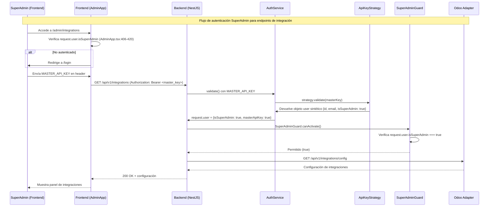

# Flujo Odoo Integrations SuperAdmin Auth — v1.43.0

> **Fecha:** 2026-10-25
> **Rama:** `feat/odoo-pos-transfer-catalog-sync`

---

## Diagrama de Secuencia Mermaid

---

## Contratos REST

### `POST /api/v1/auth/login-master`
- **Request:** `{ "masterApiKey": "<MASTER_API_KEY>" }`
- **Response 200:** `{ "access_token": "<jwt>", "user": { "id": "master", "isSuperAdmin": true } }`
- **Response 401:** `{ "message": "Invalid master API key", "statusCode": 401 }`

### `GET /api/v1/integrations`
- **Headers:** `Authorization: Bearer <MASTER_API_KEY>`
- **Response 200:** `[{ "id": "odoo-pos", "name": "Odoo 14 POS", "status": "active" }]`
- **Response 403:** `{ "message": "Forbidden", "statusCode": 403 }` (no SuperAdmin)

---

## Hitos de Telemetría (t0…tN)

| Hito | Descripción | Métrica |
|------|-------------|---------|
| t0 | SuperAdmin accede a /admin/integrations | `admin.integrations.access_attempt` |
| t1 | Auth.service recibe MASTER_API_KEY | `auth.master_key.received` |
| t2 | ApiKeyStrategy valida y devuelve user sintético | `auth.master_key.validated` |
| t3 | SuperAdminGuard permite el acceso | `auth.superadmin.allowed` |
| t4 | Endpoint de integraciones responde 200 | `integrations.get.duration_ms` |
| t5 | Frontend muestra panel de integraciones | `admin.integrations.loaded` |

---

## Validación

- [x] Diagrama de secuencia completo (t0…t5).
- [x] Contratos REST documentados.
- [x] Hitos de telemetría definidos.
- [ ] E2E tests ejecutados (pendiente de `./scripts/init.sh`).
- [ ] Métricas Prometheus registradas (pendiente de implementación).