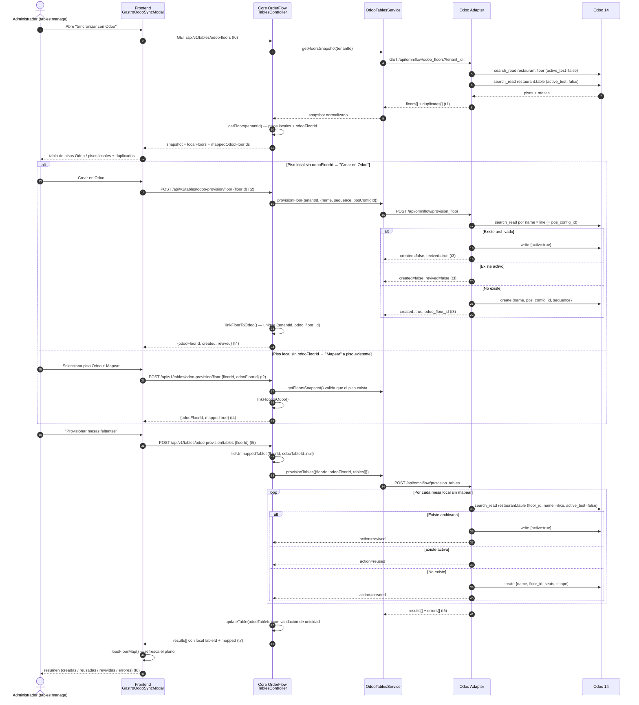

# Flujo — Provisioning de pisos y mesas OmniGastro → Odoo 14 (FEAT-201)

> **Vertical:** OmniGastro · **Versión:** 1.41.0 · **Estado:** implementado (pendiente E2E en localhost)
> **Regla:** Diagram-Driven Development + Telemetry-First (AGENTS.md #13)

## 1. Objetivo

OmniGastro es la fuente de verdad del salón. Cuando el restaurante crea o renombra un piso o una mesa
en OmniGastro, el `pos.config` de Odoo 14 queda desactualizado y el POS del mozo no puede colgar el
`pos.order` de un `restaurant.table`. Este flujo **provisiona** (crea o reutiliza) pisos y mesas en
Odoo de forma **idempotente**, sin duplicar, sin archivar y sin borrar nada en el ERP.

## 2. Actores

| Actor | Rol |
|---|---|
| Administrador (`tables:manage`) | Dispara la sincronización desde `/admin/gastro/tables` |
| Frontend (`gastro-odoo-sync-modal.tsx`) | Muestra el diff local↔Odoo y ejecuta las acciones |
| Core OrderFlow (`TablesController` / `OdooTablesService`) | Valida RBAC, persiste el mapeo y orquesta |
| Odoo Adapter (`/api/omniflow/*`) | Traduce a XML-RPC/JSON-RPC contra Odoo 14 |
| Odoo 14 (`restaurant.floor`, `restaurant.table`) | ERP destino; `pos_config_id` asocia el piso al POS |

## 3. Diagrama de secuencia

## 4. Contratos REST

### Core OrderFlow (JWT + `tables:view` / `tables:manage`)

| Método | Ruta | Permiso | Respuesta |
|---|---|---|---|
| `GET` | `/api/v1/tables/odoo-floors` | `tables:view` | `{ floors[], duplicates[], localFloors[], mappedOdooFloorIds[], fetchedAt }` |
| `POST` | `/api/v1/tables/odoo-provision/floor` | `tables:manage` | `{ floorId, odooFloorId, name, created, revived, active, mapped? }` |
| `POST` | `/api/v1/tables/odoo-provision/tables` | `tables:manage` | `{ floorId, odooFloorId, results[], errors[] }` |

`POST .../odoo-provision/floor` acepta:
- `{ floorId }` → crea o reutiliza por nombre normalizado (idempotente).
- `{ floorId, odooFloorId }` → mapeo explícito a un `restaurant.floor` existente.

`POST .../odoo-provision/tables` acepta `{ floorId, tableIds? }`. Las mesas con `odooTableId` ya
presente **nunca** se tocan (permite reintentar sin sobrescribir mapeos manuales).

### Adapter (`X-API-Key` interno)

| Método | Ruta | Cuerpo |
|---|---|---|
| `GET` | `/api/omniflow/odoo_floors?tenant_id=` | — |
| `POST` | `/api/omniflow/provision_floor` | `{ tenant_id, name, sequence?, pos_config_id? }` |
| `POST` | `/api/omniflow/provision_tables` | `{ tenant_id, floor_id, tables: [{ name, seats?, shape? }] }` |

## 5. Hitos de telemetría (obligatorios en el código)

| Hito | Evento | Dónde se emite | KPI |
|---|---|---|---|
| **t0** | Apertura del modal / inicio de snapshot | `GastroOdooSyncModal` → `GET odoo-floors` | Frecuencia de uso de la sincronización |
| **t1** | Snapshot recibido (pisos + duplicados) | `OdooTablesService.getFloorsSnapshot` | Latencia Odoo ↔ adapter ↔ core; nº de pisos duplicados |
| **t2** | Inicio del provisioning de piso | `POST odoo-provision/floor` | Intentos por piso |
| **t3** | Piso resuelto en Odoo (created / reused / revived) | Adapter `provision_floor` | % de pisos creados vs reutilizados (calidad del match) |
| **t4** | Mapeo local persistido (`restaurant_floors.odoo_floor_id`) | `TablesService.linkFloorToOdoo` | Pisos sin mapear por tenant |
| **t5** | Inicio de provisioning de mesas | `POST odoo-provision/tables` | Mesas pendientes por piso |
| **t6** | Mesas resueltas en Odoo (`results[]` / `errors[]`) | Adapter `provision_tables` | % created/reused/revived; tasa de error por mesa |
| **t7** | Mapeo local de mesas persistido (`restaurant_tables.odooTableId`) | `TablesService.updateTable` | Mesas sin `odooTableId` |
| **t8** | Sincronización completada y plano refrescado | `onDone` → `loadFloorMap()` | Tiempo total de sincronización (t8 − t0) |

> Los nombres `t0…tN` de esta tabla son los que deben usarse en los logs/eventos cuando se instrumente
> la feature (regla #13). Hoy el flujo expone los timestamps `fetchedAt` / `createdAt` y el estado
> `results[].action`; la instrumentación de métricas queda como paso siguiente al E2E.

## 6. Invariantes de negocio

1. **Idempotencia:** repetir el provisioning no duplica pisos ni mesas (match por nombre normalizado:
   `trim` + colapso de espacios + case-insensitive).
2. **Nunca destructivo:** el flujo no archiva ni borra registros en Odoo; sólo crea, reutiliza o revive.
3. **Un piso de Odoo por piso local:** índice único `(tenantId, odoo_floor_id)`; el error se muestra
   indicando qué piso local ya lo tiene.
4. **Mapeos manuales intactos:** las mesas con `odooTableId` no se re-provisionan.
5. **Odoo 14 CE:** el piso se asocia al POS con `pos_config_id`; **nunca** se escribe `config.floor_ids`
   con una sesión abierta (Odoo lo rechaza).
6. **Shape:** Odoo sólo acepta `square` / `round`; `RECT` degrada a `square`.

## 7. Errores y mapeo HTTP

| Origen | Código | Excepción Nest |
|---|---|---|
| Adapter no alcanzable (red) | — | `503 ServiceUnavailable` |
| Adapter responde 5xx | 5xx | `503 ServiceUnavailable` |
| Adapter responde 4xx (validación) | 4xx | `400 BadRequest` |
| Piso de Odoo inexistente al mapear | — | `400 BadRequest` |
| Piso local ya vinculado a ese `odooFloorId` | — | `400 BadRequest` |
| Mesa local sin `odooFloorId` al provisionar mesas | — | `400 BadRequest` |

## 8. Referencias

- Plan: `docs/plans/omnigastro/plan-actualizacion-v1.41.0-floors-provisioning.md`
- Odoo 14 CE: `restaurant.floor` (name, pos_config_id, sequence, active),
  `restaurant.table` (name, floor_id, seats, shape, active)
- Endpoints previos (sentido Odoo → OmniGastro): `GET /api/v1/tables/odoo-tables`,
  `PATCH /api/v1/tables/:id/odoo-table` (FEAT-184)
