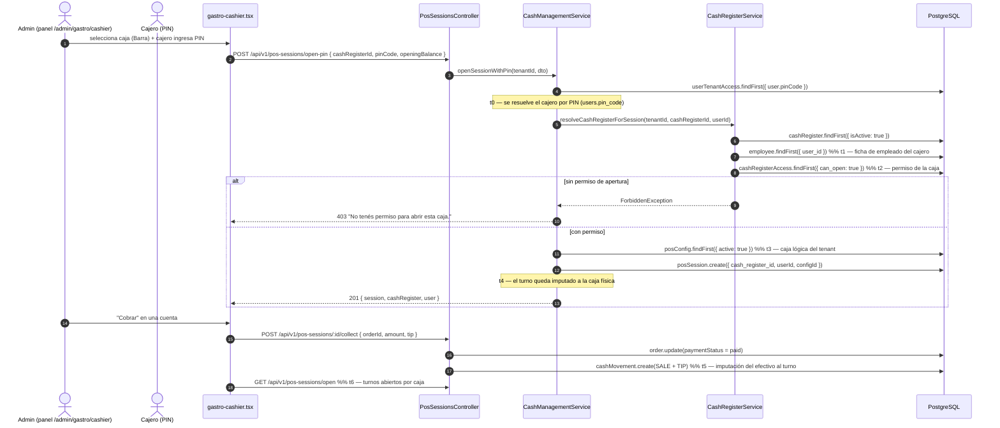

# Flujo: Cobro centralizado multi-caja (caja física por sesión)

> **Feature:** FEAT-193 · **Versión:** v1.39.18 · **Vertical:** OmniGastro
> **Estado:** Production Ready (pendiente de deploy a `provecchio.com`)
> **Auditoría:** `auditoria-caja-sesion-caja-fisica.md`

---

## 1. Concepto

En un restaurante con varios puntos de cobro (barra, terraza, salón, caja auxiliar) cada **caja física**
es un punto de cobro independiente. El modelo de OrderFlow separa tres cosas que solían confundirse:

| Concepto | Tabla | Cardinalidad por tenant | Quién lo define |
|---|---|---|---|
| **Caja lógica / terminal** | `pos_configs` | 1 por terminal POS (hoy 1) | Configuración del POS |
| **Caja física / punto de cobro** | `cash_registers` | N (hoy 4) | Administración del local |
| **Turno de caja** | `pos_sessions` | N simultáneas | El cajero, al abrir con su PIN |

La regla de negocio: **cada turno de caja pertenece a un cajero (PIN) y a una caja física**. El arqueo
de cada caja se calcula sobre los movimientos de sus turnos, no sobre una caja única.

---

## 2. Diagrama de secuencia



---

## 3. Contratos REST

| Método | Ruta | Auth | Descripción |
|---|---|---|---|
| `GET` | `/api/v1/cash-registers` | JWT / API key | Cajas del tenant (catálogo de puntos de cobro) |
| `POST` | `/api/v1/cash-registers` | JWT (`cash:manage`) | Alta de caja física |
| `POST` | `/api/v1/cash-registers/access` | JWT (`cash:manage`) | Permiso de un empleado sobre una caja |
| `POST` | `/api/v1/pos-sessions/open-pin` | JWT / API key | **Abre turno** con PIN, anclado a `cashRegisterId` |
| `GET` | `/api/v1/pos-sessions/open` | JWT / API key | Turnos abiertos del tenant (caja + cajero) |
| `GET` | `/api/v1/pos-sessions/active?cashRegisterId=` | JWT / API key | Turno abierto de una caja concreta |
| `POST` | `/api/v1/pos-sessions/:id/collect` | JWT | Cobra una cuenta y la imputa al turno |
| `POST` | `/api/v1/pos-sessions/:id/close` | JWT | Cierra el turno y calcula el arqueo Z |

### 3.1 `POST /api/v1/pos-sessions/open-pin`

```json
{
  "cashRegisterId": "062ec9af-7ef7-491e-814a-a921ceb97a7d",
  "pinCode": "1234",
  "openingBalance": 0,
  "deviceLabel": "Web Admin"
}
```

| Campo | Requerido | Notas |
|---|---|---|
| `cashRegisterId` | ❌ | Caja física. Si no viene, el turno queda sin caja (caja lógica). |
| `pinCode` | ✅ | Se valida contra `users.pin_code` del tenant. |
| `openingBalance` | ✅ | Fondo con el que abre el turno. |
| `configId` | ❌ | Caja lógica. Si no viene se resuelve el `pos_config` activo. |
| `deviceLabel` | ❌ | Origen del turno (Terminal Web, tablet…). |
| `notes` | ❌ | Nota libre. |

Errores:

| Código | Causa |
|---|---|
| `400` | PIN inválido / usuario inactivo · cajero ya tiene un turno abierto · cajero sin ficha de empleado |
| `403` | El cajero no tiene permiso `can_open` sobre esa caja |
| `404` | Caja física inexistente o inactiva · `pos_config` inexistente |

---

## 4. Hitos de telemetría

| Hito | Momento | Dato persistido | KPI de negocio |
|---|---|---|---|
| `t0` | Resolución del cajero por PIN | `pos_sessions.userId` | % de aperturas con PIN vs. apertura administrativa |
| `t1` | Ficha de empleado del cajero | `employees.user_id` | Cajeros sin ficha (no pueden abrir caja) |
| `t2` | Permiso `can_open` de la caja | `cash_register_access` | Acces denegados por caja y motivo |
| `t3` | Resolución de la caja lógica | `pos_sessions.configId` | Terminales activas por tenant |
| `t4` | Imputación del turno a la caja | `pos_sessions.cash_register_id` | % de turnos imputados (objetivo 100 %) |
| `t5` | Imputación del efectivo | `cash_movements.pos_session_id` | Diferencia esperado vs. real por caja |
| `t6` | Estado de turnos por caja | lectura de `pos_sessions` | Cajas abiertas simultáneas / tiempo de turno |

Los nombres `t0…t6` son los mismos que usa la implementación y la auditoría; cualquier cambio debe
actualizar los tres documentos a la vez.

---

## 5. Reglas de negocio

1. Un cajero **no puede tener dos turnos abiertos** a la vez (`pos_sessions.state = OPENED`).
2. Un cajero **solo abre las cajas** para las que tiene `cash_register_access.can_open = true`.
3. El cajero debe tener **ficha de empleado** vinculada (`employees.user_id`) para abrir una caja.
4. El turno guarda **siempre** la caja lógica (`configId`) y, si se indicó, la física (`cashRegisterId`).
5. Al borrar una caja, sus turnos quedan sin caja (`cash_register_id = null`), no se borran.
6. El PIN se valida contra `users.pin_code` (no contra `employees.pin_code`).

---

## 6. Cajas configuradas en `provecchio.com` (2026-10-20)

| Caja | Code | Ubicación | Cajeros con acceso |
|---|---|---|---|
| Caja Principal | `CASHIER_1` | Salón Principal | Natalia, Ninfa, Giovanni, Giuliana |
| Barra | `CASHIER_2` | Barra | Ninfa, Giovanni |
| Terraza | `CASHIER_3` | Terraza | Ninfa, Giuliana |
| Caja Auxiliar | `CASHIER_4` | Salón | Natalia, Giovanni |

Total: 4 cajas, 10 permisos.
