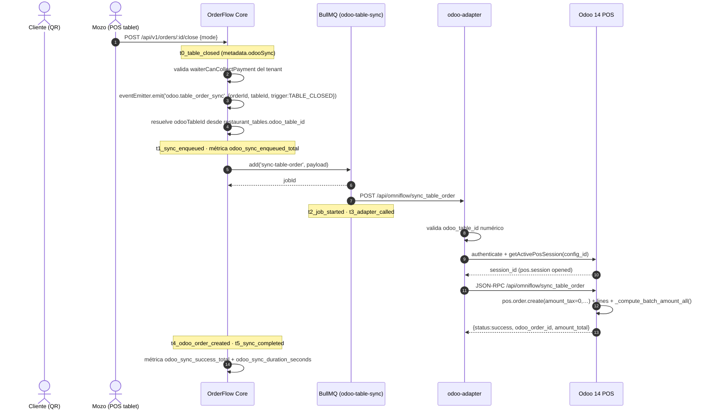

# Flujo: Sincronización de pedidos OrderFlow → Odoo 14 POS

> **Vertical:** OmniGastro · **Feature:** FEAT-184…FEAT-188 · **Versión:** `1.39.11`
> **Origen:** bug #7 del reporte del cliente v1.39.9 (`BACKLOG_CLIENTE_20261019.md`)
> **Plan maestro:** [`PLAN_ODOO_POS_SYNC_2026-10-19.md`](./PLAN_ODOO_POS_SYNC_2026-10-19.md)

---

## 1. Actores

| Actor | Rol en el flujo |
|---|---|
| **Cliente (QR)** | Genera el pedido en la mesa (`/?t=<qrToken>`) |
| **Mozo (POS tablet)** | Reclama, añade líneas, envía a cocina y **cierra la mesa** (disparador del sync) |
| **KDS (TV de cocina)** | Consume el ticket; no participa en el sync a Odoo |
| **OrderFlow Core** | Backend NestJS: emite el evento, encola en BullMQ, registra telemetría |
| **BullMQ / Redis** | Cola `odoo-table-sync` con reintentos (3 intentos, backoff exponencial) |
| **odoo-adapter** | Servicio Node: resuelve la integración Odoo del tenant y habla con el ERP |
| **Odoo 14 POS (ERP)** | `pos.config` + `pos.session` abierta; recibe el `pos.order` en borrador |

---

## 2. Secuencia



---

## 3. Contratos REST

### 3.1 OrderFlow → BullMQ

```jsonc
// backend/src/queues/odoo-table-sync.types.ts
{
  "tenantId": "provecchio-dimora-001",
  "orderId": "9fb72cde-3325-421b-b5ae-cb376a0b5d42",
  "orderUuid": "9fb72cde-3325-421b-b5ae-cb376a0b5d42",
  "odooConfigId": 2,          // pos.config de Odoo (Giardino)
  "odooTableId": 25,          // restaurant.table.id NUMÉRICO (nunca "G5")
  "trigger": "TABLE_CLOSED",  // KITCHEN | TABLE_CLOSED | MANUAL
  "items": [
    { "odooProductId": 1680, "quantity": 2, "unitPrice": 12.5, "kitchenNotes": "sin cebolla" }
  ]
}
```

### 3.2 OrderFlow → odoo-adapter

`POST {ODOO_ADAPTER_URL}/api/omniflow/sync_table_order`

```jsonc
{
  "tenant_id": "provecchio-dimora-001",
  "order_uuid": "9fb72cde-...",
  "odoo_config_id": 2,
  "odoo_table_id": 25,
  "items": [ { "odooProductId": 1680, "quantity": 2, "unitPrice": 12.5, "kitchenNotes": "" } ]
}
```

Respuesta: `{ "success": true, "status": "success", "odoo_order_id": 31957, "amount_total": 35, "amount_tax": 0 }`

### 3.3 odoo-adapter → Odoo (JSON-RPC)

`POST /api/omniflow/sync_table_order` (ruta `type='json'` del addon `pos_omniflow_sync`)

```jsonc
{
  "session_id": 1594,   // pos.session abierta
  "table_id": 25,       // restaurant.table.id
  "order_uuid": "9fb72cde-...",
  "lines": [ { "product_id": 1680, "qty": 2, "price_unit": 12.5, "notes": "" } ]
}
```

### 3.4 Diagnóstico (sin escritura)

`GET /api/v1/tables/odoo-tables` → listados de `restaurant.table` + `pos.session` abiertas.
`PATCH /api/v1/tables/:id/odoo-table` → asigna/limpia el mapeo validando contra el ERP.

---

## 4. Hitos de telemetría (t0…tN)

Se guardan en `order.metadata.odooSync.milestones` con la nomenclatura exacta de
`backend/src/queues/odoo-sync-telemetry.service.ts` (`ODOO_SYNC_MILESTONES`).

| Hito | Momento | Métrica asociada |
|---|---|---|
| `t0_table_closed` | El mozo cierra la mesa / envía a caja | — |
| `t1_sync_enqueued` | El listener encoló el job en BullMQ | `odoo_sync_enqueued_total` |
| `t2_job_started` | El processor tomó el job | — |
| `t3_adapter_called` | Se invocó al odoo-adapter | — |
| `t4_odoo_order_created` | Odoo devolvió el `odoo_order_id` | — |
| `t5_sync_completed` | Sync finalizado (éxito o error) | `odoo_sync_success_total` / `odoo_sync_failed_total` |

**Métricas Prometheus** (`GET /metrics`):

| Métrica | Tipo | Labels |
|---|---|---|
| `odoo_sync_enqueued_total` | counter | `tenant_id`, `trigger` |
| `odoo_sync_success_total` | counter | `tenant_id`, `trigger` |
| `odoo_sync_failed_total` | counter | `tenant_id`, `trigger`, `reason` |
| `odoo_sync_skipped_total` | counter | `tenant_id`, `trigger`, `reason` |
| `odoo_sync_duration_seconds` | histogram | `tenant_id`, `trigger` |

**KPI**: latencia p95 `t0_table_closed → t4_odoo_order_created` **< 5 s**.

---

## 5. Reglas de dominio

1. `odoo_table_id` es **siempre numérico**. El número de mesa legible (`"G5"`) nunca
   se envía como id de Odoo (`int("G5")` → `ValueError` → HTTP 500).
2. Sin mapeo de mesa → el sync se **omite** y se registra `odoo_sync_skipped_total`
   con `reason=missing_table_mapping`. No se inventan ids.
3. Idempotencia por `pos_reference = "OmniFlow-<order_uuid>"`: reenviar el mismo pedido
   reutiliza el `pos.order` en borrador de la mesa y la sesión, nunca lo duplica.
4. El cobro en mesa (`WAITER_CUSTODY`) solo es válido si el tenant tiene
   `waiterCanCollectPayment = true` (en Provecchio el pago se gestiona en la caja).
5. `tenantId` es sagrado: el adapter resuelve la integración Odoo **por tenant**.

---

## 6. Fallos conocidos y su causa raíz

| ID | Síntoma | Causa raíz | Dónde se corrige |
|---|---|---|---|
| D1 | HTTP 500 `invalid literal for int() with base 10: 'G5'` | Se enviaba `tableNumber` como id de Odoo | `orders.service.ts` + `odoo-table-sync.listener.ts` |
| D2 | Sin correspondencia mesa ↔ mesa Odoo | No existía `restaurant_tables.odoo_table_id` | `schema.prisma` + migración `20261019233000_odoo_pos_sync_mapping` |
| D3 | HTTP 500 `Field: Taxes (amount_tax)` | `pos.order.amount_tax` es `required=True` **sin `compute`** en el core de Odoo 14; el RPC no dispara el onchange | Addon `pos_omniflow_sync` (pasa importes y recalcula con `_compute_batch_amount_all()`) |
| D3-bis | HTTP 500 `Field: Subtotal w/o Tax (price_subtotal)` | `pos.order.line.price_subtotal` / `price_subtotal_incl` también son `required=True` sin `compute` | Addon `pos_omniflow_sync` (`_omniflow_line_amounts`) |
| D4 | El cierre de mesa no llegaba a Odoo | Solo "enviar a cocina" emitía el evento | `orders.service.guestClose` (trigger `TABLE_CLOSED`) |
| D5 | Plugins por env fallaban | `ODOO_DB=wellnesscoffee` (base inexistente) | `docker-compose.yml` → `ODOO_DB=prod` |
| D6 | Worker legacy compitió por el nombre de cola | `TableSyncWorker` leía `odoo-table-sync` (Redis plano) mientras el backend usa BullMQ | Worker eliminado del `odoo-adapter` |
| D7 | Los fallos no se veían | Sin métricas ni trazabilidad | `odoo-sync-telemetry.service.ts` + `/metrics` |
| **D8** | **El job nunca se encolaba** | `BullModule.forRootAsync` solo leía `REDIS_HOST` (inexistente en todos los `.env`) → caía a `localhost:6379` = el propio contenedor, no Redis. `queue.add()` no resolvía nunca | `backend/src/queues/queues.module.ts` deriva la conexión de `REDIS_URL` |
| **D9** | **El contenedor arrancaba con un Prisma Client viejo** | El volumen anónimo `/app/node_modules` tapaba el `node_modules` de la imagen → se ignoraba el cliente generado en el build | `docker-compose.yml` (se elimina el volumen) + `Dockerfile.dev` (`ARG CACHE_BUST`) |
| **D10** | La tabla `omnigastro_settings` no existía en ninguna base | El módulo `omnigastro-config` (v1.39.7) se despliega sin migración Prisma: la tabla se creó a mano y no existe ni en producción (167 tablas en el dump, sin ella) | La migración `20261019233000_odoo_pos_sync_mapping` la crea de forma idempotente |
| **D11** | `invalid literal for int() with base 10: '<uuid>'` al enviar las líneas | El listener enviaba `odooProductId = line.productId` (UUID de OrderFlow). El campo `Product.odooProductId` no existe: el mapeo real es por **SKU** (`skuInterno` == `default_code`) | El listener envía `sku`/`barcode`; el adapter resuelve el `product.product` por SKU o código de barras (`findProductBySkuOrBarcode`) y omite las líneas sin equivalente (`skipped_lines`) |

> **Nota de compatibilidad del addon:** Odoo 14 no expone `pos.config._get_bus_channel_name`
> ni `bus.bus._sendone` ( APIs de Odoo 18/19 ). La notificación al POS es *best-effort*
> y nunca invalida la sincronización; en Odoo 14 el POS refresca por polling
> (`pos.config.get_tables_order_count`).

---

## 6.1 Ajustes de infraestructura aplicados (v1.39.11)

Estos ajustes son **independientes del addon de Odoo** ycorrían también en
provecchio: sin ellos, el sync no llega a encolarse aunque todo lo demás
esté bien.

### A) `backend/src/queues/queues.module.ts` — conexión BullMQ desde `REDIS_URL`

```ts
// Antes: solo REDIS_HOST -> 'localhost' (dentro del contenedor = el propio backend)
const redisHost = configService.get<string>('REDIS_HOST') || 'localhost';
```

Ahora se parsea `REDIS_URL` (que sí está en todos los `.env`) y se usa
`REDIS_HOST`/`REDIS_PORT`/`REDIS_PASSWORD` solo como fallback. Sin este cambio,
`queue.add()` se quedaba colgado en silencio: **ninguna** cola del backend
(webhooks, follow-up, impresión de cocina, sync Odoo) recibía trabajos.

### B) `docker-compose.yml` — se elimina el volumen anónimo `/app/node_modules`

```yaml
volumes:
  # Sin volumen anónimo en /app/node_modules: el volumen tapa el node_modules
  # de la imagen y el contenedor arranca con un Prisma Client viejo
  - ./uploads:/app/uploads
```

Un volumen anónimo sobre `/app/node_modules` **oculta** el `node_modules` de la
imagen: el contenedor arrancaba siempre con el cliente Prisma del primer build,
ignorando el recién generado. Se manifiesta como
`Unknown field 'odooTableId' for select statement` tras cualquier cambio de schema.

> Los volúmenes anónimos de `odoo_adapter` y `sync_standalone` **se mantienen**:
> esos servicios sí montan su código por bind mount y en producción el volumen
> anónimo es lo que aporta el `node_modules` (el host no lo tiene).

### C) `backend/Dockerfile.dev` — `ARG CACHE_BUST`

```dockerfile
ARG CACHE_BUST=1
RUN echo "prisma cache-bust=${CACHE_BUST}" > /tmp/prisma-cache-bust
RUN npx prisma generate
```

Sin un ARG que cambie, buildkit reutiliza la capa de `prisma generate` de un
build anterior. `scripts/deploy-production.sh` inyecta `CACHE_BUST=$(cat VERSION)`
antes del `build`, de forma que **cada release regenera el cliente**.

### D) `scripts/backup-production.sh` — resolución dinámica del contenedor de BD

El backup fallaba con `service 'database' is not running` porque la línea
original invocaba `docker compose -f docker-compose.prod.yml ... exec -T database`,
pero en provecchio la pila se levanta con `docker-compose.yml` +
`docker-compose.provecchio.yml` y el servicio se llama `postgres`
(contenedor `orderflow_db`). Ahora se resuelve el contenedor en caliente sobre
los contenedores en ejecución, sin atar el backup a un compose o servicio concreto.

### E) Migración autocontenida (`20261019233000_odoo_pos_sync_mapping`)

```sql
CREATE TABLE IF NOT EXISTS "omnigastro_settings" ( ... );   -- si no existe
ALTER TABLE "omnigastro_settings" ADD COLUMN IF NOT EXISTS "waiter_can_collect_payment" ...;
ALTER TABLE "omnigastro_settings" ADD COLUMN IF NOT EXISTS "odoo_pos_config_id" INTEGER;
```

Es idempotente y segura tanto en producción (donde la tabla puede existir) como
en bases nuevas o derivadas (donde no existe). Las columnas nuevas usan
`snake_case` con `@map` (AGENTS.md §2.4); la tabla preexistente conserva sus
nombres camelCase porque forma parte de la zona legacy (§2.4.2).

### F) `odoo-adapter/src/index.js` — los errores de Odoo ya no se reportan como éxito

El addon devuelve `{status: 'error', message}` sin lanzar excepción. El adapter
lo traducía a `success: true`, de modo que BullMQ no reintentaba y la métrica
contaba un sync fallido como correcto. Ahora se devuelve HTTP 502 y el fallo se
propaga al processor (reintentos + `odoo_sync_failed_total`).

---

## 7. Operación

```bash
# Desplegar el addon en el ERP (backup + reinicio). Requiere autorización.
./scripts/deploy-odoo-addon.sh --apply

# Prueba de contrato contra el ERP (crea y borra un pos.order de prueba)
cd odoo-adapter && node test-pos-order-contract.js

# Mapa de mesas OrderFlow -> Odoo (DRY-RUN por defecto)
cd backend && npx ts-node prisma/seed-odoo-table-mapping.ts --tenant <tenantId> [--apply]
```

**Rollback del addon**: restaurar `/opt/odoo/backups/pos_omniflow_sync_<timestamp>.tar.gz`
en `/opt/odoo/addons/` y reiniciar `odoo_web_8081`.
