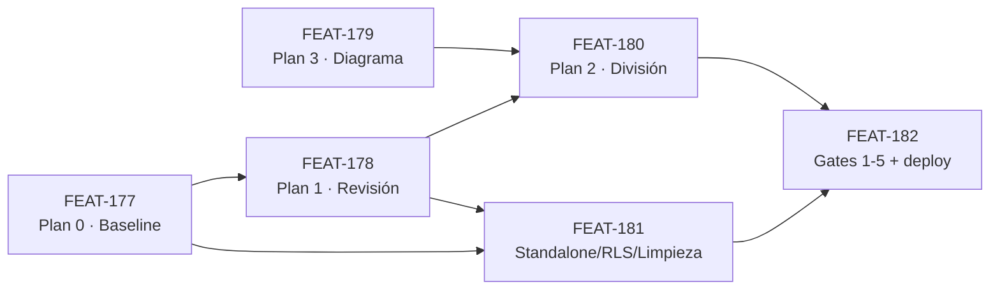

# PLAN MAESTRO — OpenCore (Schema Prisma)

> Consolidado de los Planes 0/1/2/3 con numeración FEAT, fases, dependencias y métricas de éxito.
> Fuente de verdad del análisis: [`Plan_analisis_schema_prisma_v4.md`](Plan_analisis_schema_prisma_v4.md).

---

## 1. Objetivo

Dejar el schema Prisma del core de OrderFlow auditado, documentado, gobernado y preparado
para una división por dominios, sin romper la multi-tenancy, la convención de columnas
(AGENTS.md §2.4) ni la operación en producción.

**Fuente de verdad operativa:** `provecchio.local` (copia local de provecchio.com). Ningún
`migrate diff` ni baseline se ejecuta contra producción.

## 2. Alcance

| Dentro | Fuera |
|---|---|
| `backend/prisma/schema.prisma` (161 modelos, 56 enums, 4.471 líneas) | Lógica de negocio de los módulos |
| 11 schemas standalone (`services/*/prisma/schema.prisma`) | Runtimes standalone (ya operativos en v1.39.10) |
| 38 carpetas de `backend/prisma/migrations` | Esquema de `provecchio.com` en producción hasta que se cumplan los 5 gates |
| Policies RLS recuperadas de `pg_policies` | Elección de snake_case vs camelCase (decisión del propietario) |

## 3. Features (numeración FEAT)

| FEAT | Título | Fase | Depende de | Estado |
|---|---|---|---|---|
| FEAT-177 | Plan 0 — Diagnóstico de schema y baseline de migraciones contra `provecchio.local` | 0 | — | planned |
| FEAT-178 | Plan 1 — Revisión del schema: aislamiento multi-tenant, tipos numéricos, índices, cascadas, `@map`, duplicados | 1 | FEAT-177 (parcial) | planned |
| FEAT-179 | Plan 3 — Diagrama de relaciones core vs standalone y métricas de acoplamiento | 3 | — | planned |
| FEAT-180 | Plan 2 — División del schema en dominios con script de migración y chequeo de deriva en CI | 2 | FEAT-178, FEAT-179 | planned |
| FEAT-181 | Standalone, RLS y limpieza: duplicados exactos, `birthday_logs.type`, RLS versionada, credencial `ODOO_PASSWORD` | 4 | FEAT-177, FEAT-178 | planned |
| FEAT-182 | Gates de salida 1-5 y merge/deploy con autorización explícita | 5 | FEAT-177..181 | planned |

Detalle de cada feature en [`featurelist.json`](featurelist.json).

## 4. Fases y secuencia

## 5. Contrato técnico

- **Convención de columnas:** toda columna nueva o modificada en `snake_case` con
  `@map("columna")` explícito; los campos Prisma siguen en `camelCase` (AGENTS.md §2.4).
  La zona legacy (`tenants`, `module_installations`, `cash_registers`, entre otras) no se
  renombra retroactivamente.
- **Nombres de migración:** carpeta `YYYYMMDDHHMMSS_descripcion` completa, sin excepción.
- **`tenantId`:** intacto en todos los modelos y consultas; los modelos que hoy no lo tienen
  son parte del informe de FEAT-178, no un cambio automático.
- **Migraciones:** idempotentes y reversibles cuando el motor lo permite; cada migración
  destructiva (columna eliminada) requiere su feature y su auditoría propias.

## 6. Telemetría y métricas de éxito

| Métrica | Objetivo | Cómo se mide |
|---|---|---|
| Modelos con `tenantId` | Sin regresión respecto al baseline | Conteo por dominio sobre `schema.prisma` vs baseline de FEAT-177 |
| Deriva migraciones ↔ schema | 0 | `prisma migrate diff` vacío (Gate 3) |
| Modelos duplicados exactos | 0 | Comparación de nombres y campos entre core y standalone (FEAT-181) |
| Columnas con `@map` sin verificar | 0 | Checklist de FEAT-177 contra `provecchio.local` |
| Gates cumplidos | 5 de 5 | Checklist de FEAT-182 |
| Build de imagen | Contexto < 1,5 GB | `du -sh backend/` + tamaño de contexto de Docker |
| Convivencia de entornos | 0 incidentes en `provecchio.com` | Health checks y E2E tras cada deploy |

## 7. Hitos de telemetría del flujo de despliegue (t0…t4)

| Hito | Momento | Señal |
|---|---|---|
| `t0` | Inicio de la fase | Rama de feature creada desde `main`, working tree limpio |
| `t1` | Baseline capturado | Conteos de modelos, enums, tablas y policies guardados en la auditoría de la fase |
| `t2` | Cambio de schema aplicado en `provecchio.local` | `migrate deploy` sin error en base existente y en base vacía |
| `t3` | Validación previa al merge | `migrate diff` vacío + `./scripts/init.sh` en verde |
| `t4` | Verificación post-deploy en producción | `/api/v1/health` con la versión nueva, E2E sobre el respaldo restaurado, sin 5xx |

## 8. Reglas de ejecución

1. Una rama por feature, creada desde `main` (`feat/...`, `fix/...`), con PR hacia `main`.
2. Nada se mergea a `main` sin `prisma validate`, `prisma format` y el gate que corresponda.
3. Todo cambio de schema va acompañado de su migración y de la auditoría de la fase.
4. Nada se ejecuta contra `provecchio.com` sin autorización explícita (AGENTS.md §9).
5. Si el diff de migraciones no es idempotente o no tiene rollback, se detiene el gate.
