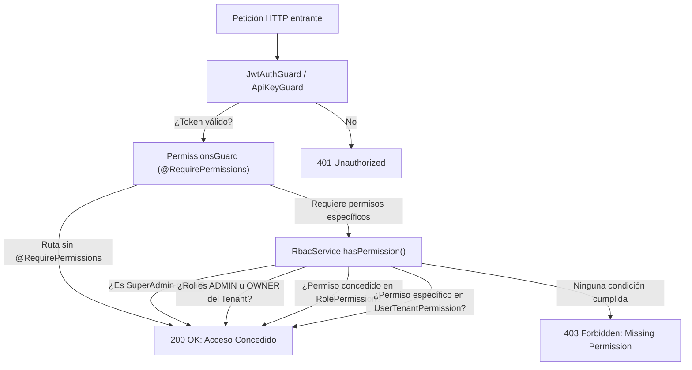

# 📘 Manual de Usuario: Roles, Políticas de Acceso (RBAC) y Seguridad (`v1.36.4`)

> **Módulo:** Seguridad, Control de Acceso (RBAC), Usuarios, Cargos y Permisos Granulares  
> **Ubicación del Documento:** `docs/user-manuals/32-manual-roles-politicas-rbac-permisos.md`  
> **Versión de OrderFlow / OmniFlow:** v1.36.4+  
> **Fecha:** 21 de Octubre de 2026  
> **Perfil:** Administradores de Tenant, Gerentes de Operaciones, Oficiales de Seguridad y Supervisores de Sala / Turno.

---

## 1. INTRODUCCIÓN Y PROPÓSITO

El sistema **OmniFlow / OrderFlow** implementa un modelo de seguridad multi-nivel basado en **Control de Acceso Basado en Roles (RBAC - Role-Based Access Control)** con aislamiento estricto por organización (`tenantId`).

Este modelo garantiza:
1. **Principio de menor privilegio:** Cada usuario dispone únicamente de las autorizaciones requeridas para su rol operativo diario.
2. **Aislamiento lógico multi-tenant:** Los datos, catálogos, pedidos y cajas de un tenant son inaccesibles para usuarios de otras organizaciones.
3. **Desacoplamiento entre Puesto de Trabajo y Nivel de Seguridad:** Los cargos del organigrama laboral (`Position` en OmniHRMS: Cajero, Mozo, Cocinero, Jefe de Sala) se enlazan con un rol base (`UserRole`), permitiendo granularidad sin proliferación desordenada de perfiles.
4. **Overrides individuales:** La posibilidad de otorgar o retirar permisos específicos a un usuario puntual dentro de una sucursal mediante excepciones (`UserTenantPermission`).

---

## 2. ARQUITECTURA DE DECISIÓN RBAC

El siguiente diagrama detalla cómo evalúa el sistema cada petición entrante a la API:



---

## 3. CATÁLOGO DE ROLES Y NIVELES DE ACCESO

### 🔴 1. `ADMIN` — Administrador Total del Tenant
* **Propósito:** Dueño del establecimiento, director general o administrador designado de la cuenta.
* **Nivel de Acceso:** **Total e irrestricto (100% de capacidades)** en el tenant.
* **Privilegios:**
  * Configuración global del negocio, moneda, facturación y pasarelas de pago.
  * Creación y gestión de usuarios, asignación de roles y turnos.
  * Gestión de todas las verticales activas: Pedidos, POS, Inventario Multibodega, KDS, RRHH, Bio-Links, CRM y OmniBI.
  * Instalación de módulos del App Store y configuración de integraciones (Odoo ERP, FacturaSend, WhatsApp Business).
  * Arqueo, cierre forzado y auditoría de diferencias en cajas.

---

### 🔵 2. `MANAGER` — Gerente / Supervisor de Turno / Jefe de Sala
* **Propósito:** Supervisión de la operación del local, liderazgo de salones y control operativo de caja.
* **Nivel de Acceso:** **Alto / Operativo y Administrativo de Piso**.
* **Privilegios:**
  * **Pedidos:** Crear, editar, despachar, cancelar y eliminar comandas (`orders:manage`, `orders:delete`).
  * **Cajas y Turnos:** Apertura y cierre de turnos POS (`cash:open_session`, `cash:close_session`), retiros/ingresos y auditoría de arqueos (`cash:audit`).
  * **Mesas y Salón:** Reasignación de mesas entre mozos (`tables:reassign`), modificación de layouts y planos (`tables:manage`), envío de cortesías y consumos de cortesía a clientes (`tables:gift`).
  * **Terminales:** Configuración y parametrización de puestos POS (`pos:config`).
* **Restricciones:** No puede modificar configuraciones globales del tenant, ni instalar módulos del core ni alterar llaves API de integración.

---

### 🟢 3. `SELLER` — Vendedor / Cajero de Mostrador / Retail
* **Propósito:** Facturación, cobro en punto de venta retail y atención rápida de mostrador.
* **Nivel de Acceso:** **Medio / Comercial y Caja**.
* **Privilegios:**
  * **Pedidos:** Crear y editar pedidos de venta en mostrador o delivery (`orders:create`, `orders:update`, `orders:read`).
  * **Caja:** Apertura de su turno asignado (`cash:open_session`) y registro de cobros (`cash:collect`).
  * **Mesas:** Visualizar y operar mesas asignadas en caso de salones mixtos (`tables:own`, `tables:status`).
* **Restricciones:**
  * No puede realizar cierres ni auditorías de arqueo (`cash:close_session`, `cash:audit` están bloqueados).
  * No puede eliminar pedidos confirmados ni aplicar cortesías libres.
  * No tiene acceso a módulos de configuración ni administración de usuarios.

---

### 👨‍🍳 4. `WAITER` — Mozo / Camarero / Barman
* **Propósito:** Atención directa de mesas, toma de comandas, comensales y precuenta.
* **Nivel de Acceso:** **Específico de Salón / Móvil**.
* **Privilegios:**
  * **Mesas:** Consultar sus mesas asignadas (`tables:own`), cambiar estado de mesa (`tables:status`), gestionar comensales (`tables:guests`) y transferir comandas a compañeros de turno (`tables:transfer`).
  * **Comandas:** Tomar y modificar pedidos en mesa (`orders:create`, `orders:update`, `orders:read`).
  * **Cobro en Mesa:** Recibir pagos bajo la modalidad **`WAITER_CUSTODY`** (custodia de efectivo o cobro con datáfono inalámbrico en mesa).
* **Restricciones:**
  * No puede abrir ni cerrar turnos de caja de mostrador (`cash:open_session`, `cash:close_session`).
  * No puede reasignar mesas de otros mozos sin autorización ni modificar el mapa de salones.
  * No puede eliminar pedidos ni aplicar descuentos o regalos no autorizados.

---

### 🟤 5. `EMPLOYEE` — Colaborador / Personal de Cocina / Nómina
* **Propósito:** Personal de soporte, operarios de cocina/KDS, anfitriones y personal sujeto a control horario.
* **Nivel de Acceso:** **Operativo Básico y Autoservicio de Personal**.
* **Privilegios:**
  * **KDS de Cocina:** Visualización de comandas en estación de preparación y despacho de platos mediante pantalla táctil / bump bar.
  * **Asistencia:** Marcado de entrada/salida por PIN, QR Kiosko, tarjeta NFC o huella biométrica (`hr:attendance:mark`).
  * **Salón Básico:** Visualizar estado de mesas y comensales (`tables:status`, `tables:guests`) para anfitriones/hosts.
  * **Portal del Empleado:** Consulta de legajo personal, comprobantes de pago y solicitud de permisos/vacaciones (`hr:leaves:create`, `hr:vacations:read`).
* **Restricciones:** Bloqueado el acceso a cualquier función de cobro, caja, facturación o edición de listas de precios.

---

### ⚪ 6. `VIEWER` — Solo Lectura / Auditor Externo
* **Propósito:** Auditores contables, directores pasivos, inspectores o consultores.
* **Nivel de Acceso:** **Consulta Pasiva**.
* **Privilegios:** Navegación en reportes y listados autorizados en modo lectura. Sin permisos de mutación (`permissionNames: []` por defecto).

---

### 🌟 7. Roles Especiales de la Plataforma

| Rol Especial | Ámbito | Descripción y Atribuciones |
| :--- | :--- | :--- |
| **`SUPERADMIN`** | Nivel SaaS Global | Acceso sin restricciones a todos los tenants de la base de datos, creación de organizaciones, observabilidad y App Store global. |
| **`OWNER`** | Organización | Identidad del fundador/creador del tenant. Posee bypass total dentro de su tenant equivalente al `ADMIN`. |
| **`API_KEY`** | Máquina / Integración | Peticiones autenticadas mediante `x-api-key`. El sistema les asigna contexto `ADMIN` sintético dentro del tenant emisor. |

---

## 4. DESACOPLAMIENTO: PUESTOS (`Position`) Y ROLES BASE

En **OmniFlow**, el cargo del empleado no se confunde con el rol técnico de seguridad. El modelo [`Position`](file:///opt/orderflow/backend/src/positions/position.service.ts) mapea la función laboral a un `baseRole`:

```
Organigrama (Position)          Rol Técnico Base (UserRole)
┌──────────────────────┐        ┌────────────────────────┐
│ Cajero (CASHIER)     │ ─────► │ SELLER                 │
├──────────────────────┤        ├────────────────────────┤
│ Mozo (WAITER)        │ ─────► │ WAITER                 │
├──────────────────────┤        ├────────────────────────┤
│ Cocinero (COOK)      │ ─────► │ EMPLOYEE               │
├──────────────────────┤        ├────────────────────────┤
│ Jefe Sala (HEAD_W.)  │ ─────► │ MANAGER                │
├──────────────────────┤        ├────────────────────────┤
│ Barman (BARMAN)      │ ─────► │ WAITER                 │
├──────────────────────┤        ├────────────────────────┤
│ Anfitrión (HOST)     │ ─────► │ EMPLOYEE               │
└──────────────────────┘        └────────────────────────┘
```

> **Ventaja operativa:** Un Cocinero y un Anfitrión comparten el rol de seguridad `EMPLOYEE`, pero sus vistas en pantalla difieren según su cargo (`Position`).

---

## 5. MATRIZ COMPARATIVA DE CAPACIDADES OPERATIVAS

| Acción / Capacidad | ADMIN | MANAGER | SELLER | WAITER | EMPLOYEE | VIEWER |
| :--- | :---: | :---: | :---: | :---: | :---: | :---: |
| **Crear y Modificar Pedidos** | ✅ | ✅ | ✅ | ✅ | ❌ | ❌ |
| **Eliminar Pedidos Confirmados** | ✅ | ✅ | ❌ | ❌ | ❌ | ❌ |
| **Cobro en Mesa (`WAITER_CUSTODY`)** | ✅ | ✅ | ✅ | ✅ | ❌ | ❌ |
| **Apertura de Caja POS** | ✅ | ✅ | ✅ | ❌ | ❌ | ❌ |
| **Cierre y Auditoría de Caja** | ✅ | ✅ | ❌ | ❌ | ❌ | ❌ |
| **Transferir Mesas de Turno** | ✅ | ✅ | ✅ | ✅ | ❌ | ❌ |
| **Reasignar Mesas Ajenas** | ✅ | ✅ | ❌ | ❌ | ❌ | ❌ |
| **Enviar Cortesías (`tables:gift`)** | ✅ | ✅ | ❌ | ❌ | ❌ | ❌ |
| **Diseño del Plano de Salón** | ✅ | ✅ | ❌ | ❌ | ❌ | ❌ |
| **Despacho en Pantalla Cocina (KDS)** | ✅ | ✅ | ❌ | ❌ | ✅ | ❌ |
| **Marcación de Asistencia / Legajo** | ✅ | ✅ | ✅ | ✅ | ✅ | ❌ |
| **Gestión de Usuarios y Roles** | ✅ | ❌ | ❌ | ❌ | ❌ | ❌ |
| **Configuración de Integraciones** | ✅ | ❌ | ❌ | ❌ | ❌ | ❌ |

---

## 6. GUÍA PASO A PASO: GESTIÓN DE ROLES EN EL PANEL ADMIN

### 🔹 Paso 1: Alta y Asignación de Roles de Usuario
1. Ingresa al panel de administración como **Administrador** (`/admin`).
2. Dirígete a **Sistema / Ajustes > Usuarios, Roles & Permisos** (`/admin/users`).
3. Haz clic en **"Nuevo Usuario"** o selecciona **"Editar"** sobre un colaborador existente.
4. En el campo desplegable **"Rol"**, selecciona el perfil correspondiente:
   * `ADMIN` — Solo para propietarios o administradores generales.
   * `MANAGER` — Para supervisores de turno y encargados de salón.
   * `SELLER` — Para cajeros y personal de ventas.
   * `WAITER` — Para mozos y personal de atención de mesas.
   * `EMPLOYEE` — Para personal operativo, cocina y nómina.
   * `VIEWER` — Para supervisores externos sin permiso de escritura.
5. Guarda los cambios. El usuario asumirá sus permisos de inmediato.

### 🔹 Paso 2: Asignación de Cargos en OmniCapitalHumano
1. Ve a **Omni Capital Humano > MOF & Organigrama** (`/admin/hr-organization`).
2. Crea o edita el cargo (`Position`), definiendo su nombre (ej: *"Cajero Principal"*), código (`CASHIER`) y su **Rol operativo** (`baseRole: SELLER`).
3. Al vincular este cargo al legajo del empleado, heredará las capacidades del rol base.

### 🔹 Paso 3: Acceso Rápido por PIN para Salón y KDS
1. Los mozos y personal de salón pueden operar estaciones compartidas introduciendo un PIN numérico de 4 a 6 dígitos configurado en su legajo.
2. El sistema valida el PIN contra los colaboradores activos del restaurante y emite un token JWT con el rol y puesto correspondiente.

---

## 7. POLÍTICA DE SEGURIDAD PARA CLIENTES Y ACCESOS PÚBLICOS

> [!IMPORTANT]
> **Endpoints Públicos (Menú QR, Bio-Links y Fast Checkout):**
> Los clientes que escanean un código QR en una mesa o visitan un enlace de Bio-Link **no son usuarios del sistema**. Sus peticiones son anónimas y no requieren login ni token.
> La plataforma resuelve el tenant automáticamente desde el token del QR (`restaurantTable.tenantId`) o el slug del comercio, garantizando una experiencia de compra inmediata sin barreras de autenticación.
